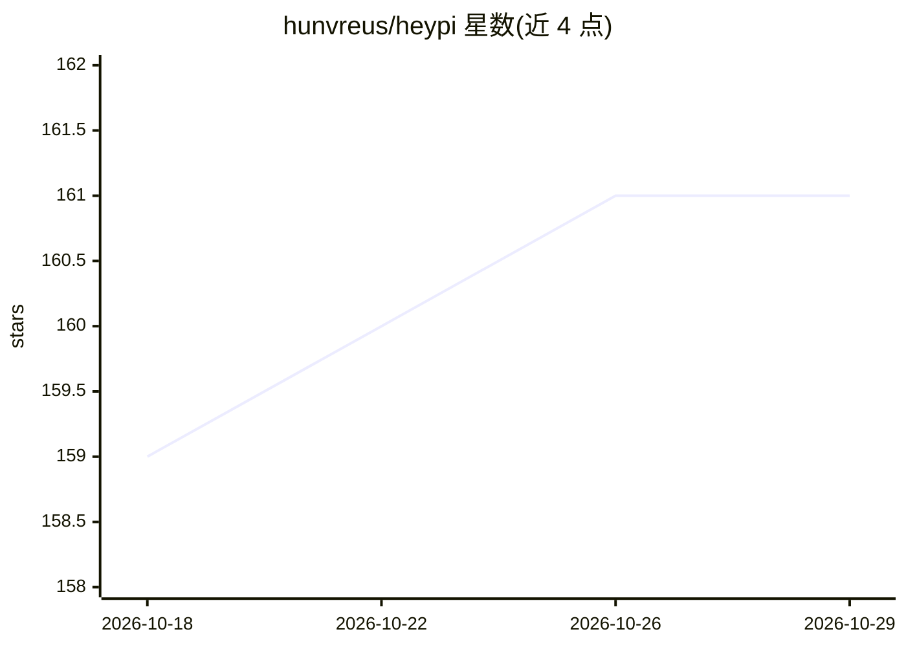

# hunvreus/heypi

⭐ 161 · TypeScript · MIT · 推送 2026-07-22 · [GitHub](https://github.com/hunvreus/heypi) · [官网](https://heypi.dev) · 个人维护

**给团队把 Pi agent 接入 Slack/Discord/Telegram 的宿主框架**

面向团队的多聊天平台 agent 宿主：将一个 Pi agent 连接到 Slack、Discord、Telegram、本地应用或受信 webhook，提供会话路由、运行时隔离（in-process、QEMU micro-VM、Vercel/Cloudflare Sandbox）、审批、记忆、附件、定时任务与操作审计记录，不替换 Pi 自身的模型循环。以 npm 库与 create 脚手架两种形式提供，模型通过环境变量指定 Pi 模型 ID 并提供对应厂商凭证。开发需 Node.js 22+ 与 pnpm 10。

## 筛选速览

| 维度 | 判定 | 备注 |
|---|---|---|
| AI 角色 | `ai-ecosystem` | LLM/agent 周边工具 |
| 许可风险 | `permissive` | MIT |
| 部署形态 | `self-host` | docker 或自建部署 |
| 模型依赖 | — | README 未给出锁定关系 |
| 硬件要求 | — | 无带数字的原话,不猜 |
| 安装摩擦 | `low` | 无编译、无系统依赖或容器化 |
| 成熟度 | — | 结构信号不足 |

## 能力要点

- 单 agent 多平台接入：Slack/Discord/Telegram/webhook/本地应用
- 四种可插拔运行时：just-bash 解释器、QEMU micro-VM、Vercel/Cloudflare Sandbox
- 审批、记忆、定时任务与操作审计记录
- 提供库形式（npm install）与项目脚手架（npm create）两种用法

## 适用场景

- 把团队 agent 部署到已有 Slack/Discord/Telegram 工作区
- 让 agent 在沙箱运行时中执行受限工具并经审批后操作
- 以库形式在自己的应用中宿主 Pi agent

## 场景标签

`Agent 框架` · 领域:Agent 开发

## 证据(README 行号)

> L5: Pi-native chat agents for teams.
> L7: heypi connects one Pi agent to Slack, Discord, Telegram, local applications, or trusted webhooks.
> L8: It adds conversation routing, runtime isolation, approvals, memory, attachments, schedules, and
> L9: operational audit records without replacing Pi's model loop.

## 星数曲线

2026-10-18 159 → 2026-10-29 161（+2）

---
*卡片 v1 · prompt 1.4 · 生成 2026-10-22 · 置信度 mid · 依据 README sha `9f26d048bd93` · [字段定义](../../DATASET.md)*
