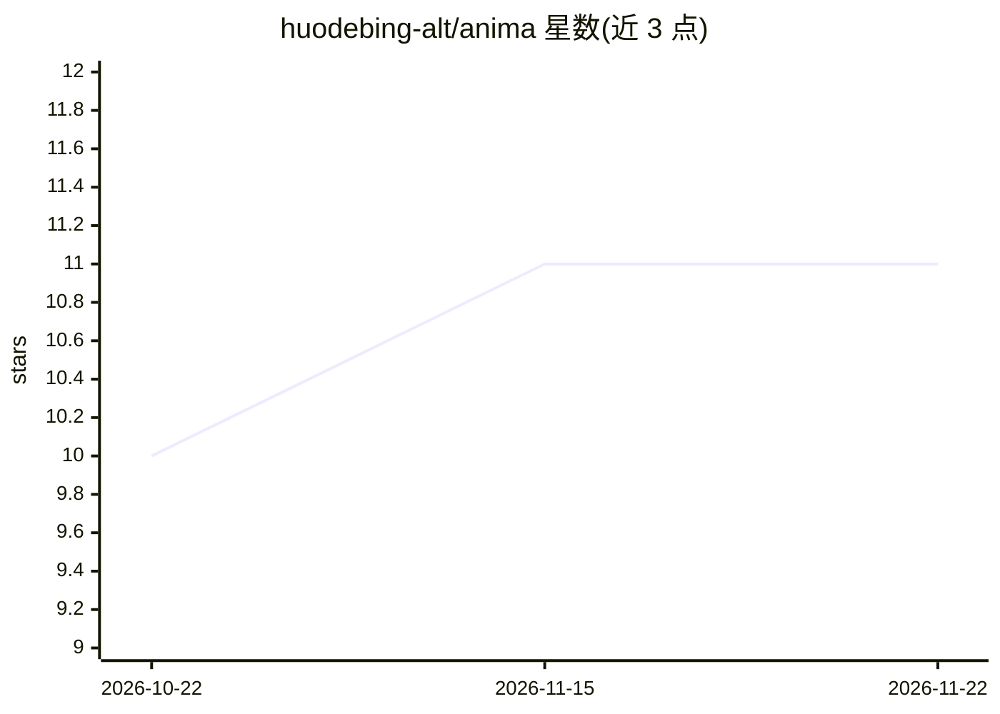

# huodebing-alt/anima

⭐ 11 · Python · MIT · 推送 2026-07-11 · [GitHub](https://github.com/huodebing-alt/anima) · 个人维护

**在本地小模型上 24/7 运行的常驻 AI agent，带持久记忆与睡眠巩固**

Anima 是运行于本机的自主 AI agent：以 Ollama + 2B 模型驱动，纯标准库 Python 实现（无 pip 依赖），跨重启保持记忆、自我模型与梦境状态。核心机制包括情景/语义/反思/梦境记忆的 SQLite 存储、按新近度×重要性×相关性检索、五阶段睡眠周期（巩固、反思、REM 式做梦、遗忘、自我模型重写）与艾宾浩斯遗忘曲线。提供终端对话与本地 Web UI（聊天、思维流、记忆检查、语音、可选摄像头），能力默认关闭需用户授权。

## 筛选速览

| 维度 | 判定 | 备注 |
|---|---|---|
| AI 角色 | `ai-native` | 本体是模型或模型工具 |
| 许可风险 | `permissive` | MIT |
| 部署形态 | `library` | 以包/库形式分发 |
| 模型依赖 | local-ok | 支持本地模型 |
| 硬件要求 | — | 无带数字的原话,不猜 |
| 安装摩擦 | `low` | 无编译、无系统依赖或容器化 |
| 成熟度 | `idea` | |

## 能力要点

- 五阶段睡眠周期：巩固、反思、REM 式做梦挖掘洞见、遗忘、自我模型重写
- 记忆按 recency×importance×relevance 检索，带强化与艾宾浩斯衰减
- 纯 stdlib Python（无 pip 依赖），单进程 + 单 SQLite 文件，100% 本地离线
- Web UI 提供聊天、思维流观察、梦境日志、记忆检查与语音交互

## 适用场景

- 在个人笔记本上长期运行一个有持久身份的 AI 伴侣
- 研究 LLM agent 的长期记忆、遗忘与睡眠巩固机制
- 本地隐私环境下尝试环境感知（文件监听、可选摄像头）agent

## 场景标签

`Agent 记忆` · 领域:Agent 开发

## 证据(README 行号)

> L3: **Anima is an open-source autonomous AI agent that runs 24/7 on your own machine, remembers everything across restar
> L13: - 🧠 **Human-like long-term memory for LLMs** — episodic, semantic, reflection, dream, and insight memories in SQLit
> L20: - 🔌 **100% local & private** — everything runs offline via the Ollama API. No cloud, no API keys, no telemetry. You

## 星数曲线

2026-10-22 10 → 2026-11-22 11（+1）

---
*卡片 v1 · prompt 1.4 · 生成 2026-11-18 · 置信度 mid · 依据 README sha `3ef5b884173f` · [字段定义](../../DATASET.md)*
