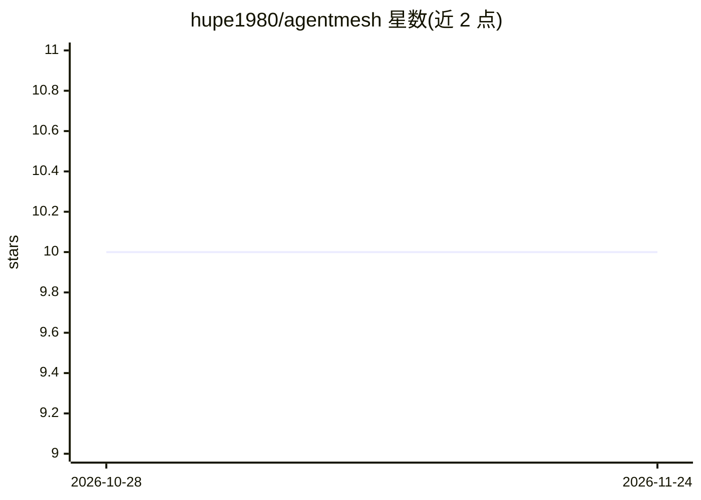

# hupe1980/agentmesh

⭐ 10 · Go · Apache-2.0 · 推送 2025-12-23 · [GitHub](https://github.com/hupe1980/agentmesh) · [官网](https://hupe1980.github.io/agentmesh/) · 个人维护

**Go 多智能体编排框架，以 Pregel BSP 图执行构建 AI 工作流**

基于 Pregel BSP 图处理模型的 Go 语言多智能体编排框架，提供并行图执行、基于通道的无锁状态管理与检查点持久化（支持加密、签名与自动恢复）、ReAct/Supervisor/RAG 等智能体模式、A2A 协议与 MCP 工具发现，并内置 OpenTelemetry 指标与分布式追踪。需要 Go 1.24+，以 go get 方式安装，examples/ 目录提供 41 个示例。

## 筛选速览

| 维度 | 判定 | 备注 |
|---|---|---|
| AI 角色 | `ai-ecosystem` | LLM/agent 周边工具 |
| 许可风险 | `permissive` | Apache-2.0 |
| 部署形态 | `None` |  |
| 模型依赖 | local-ok | 支持本地模型 |
| 硬件要求 | — | 无带数字的原话,不猜 |
| 安装摩擦 | `low` | 无编译、无系统依赖或容器化 |
| 成熟度 | — | 结构信号不足 |

## 能力要点

- Pregel BSP 并行图执行与状态检查点（加密、签名、自动恢复）
- 接入 OpenAI、Anthropic、Gemini、Amazon Bedrock、Ollama 并支持流式与推理模型
- A2A 多智能体协作协议与 MCP 动态工具发现
- 内置 OpenTelemetry 指标、追踪与重试/熔断等韧性配置

## 适用场景

- 用 Go 编排多智能体工作流并需要并行执行与状态持久化
- 构建带人工审批环节的智能体流程
- 将已有工具通过 MCP 服务器接入智能体并做可观测性监控

## 场景标签

`多智能体` `Agent 框架` `RAG` · 领域:Agent 开发

## 证据(README 行号)

> L8: > Production-grade multi-agent orchestration framework powered by Pregel-style bulk-synchronous parallel (BSP) graph
> L16: - **🧠 LLM Integration** - Native support for OpenAI, Anthropic, Gemini, Amazon Bedrock, Ollama with streaming and r
> L37: - **🤝 A2A Protocol** - Multi-agent collaboration with standardized communication

## 星数曲线

2026-10-28 10 → 2026-11-24 10（+0）

---
*卡片 v1 · prompt 1.4 · 生成 2026-11-19 · 置信度 high · 依据 README sha `ae8ec0573de7` · [字段定义](../../DATASET.md)*
