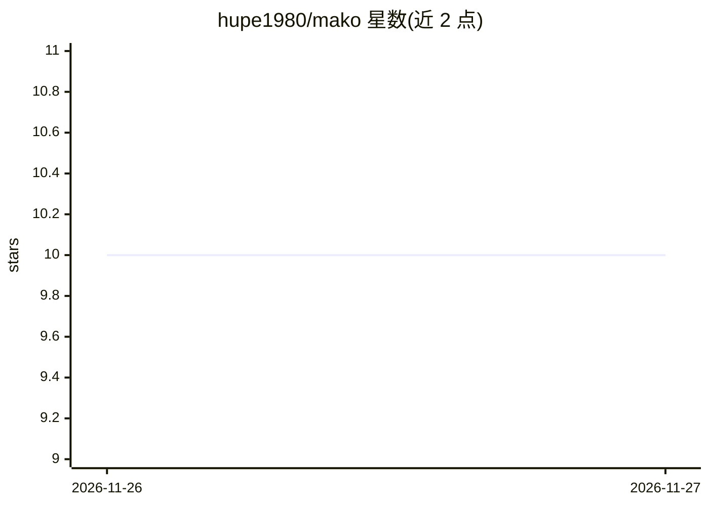

# hupe1980/mako

⭐ 10 · Rust · Apache-2.0 · 推送 2026-11-25 · [GitHub](https://github.com/hupe1980/mako) · [官网](https://hupe1980.github.io/mako/) · 个人维护

**德国能源市场的市场通信与结算运行平台，含 AI 助手**

以 Rust 编写的开源平台，运行德国电力与天然气市场的市场通信与结算：按 BDEW 校验 EDIFACT 报文、覆盖 83 个工作流与 499 个 Prüfidentifikatoren、AS4 双向 TLS 通信，并提供电网结算、EEG 结算、零售计费、合同与客户门户等服务。AI 部分为 14 个服务中 11 个暴露 MCP 服务器（212 个工具），agentd 作为受治理的消费端运行 30 个专家 agent， Desk 中助手给出带引用的提案并由人工确认后发送。当前为实验阶段，首个正式版本发布前 API 可能变更。

## 筛选速览

| 维度 | 判定 | 备注 |
|---|---|---|
| AI 角色 | `ai-enhanced` | 去掉 AI 部分产品仍成立 |
| 许可风险 | `permissive` | Apache-2.0 |
| 部署形态 | `library` | 以包/库形式分发 |
| 模型依赖 | — | README 未给出锁定关系 |
| 硬件要求 | — | 无带数字的原话,不猜 |
| 安装摩擦 | `low` | 无编译、无系统依赖或容器化 |
| 成熟度 | `idea` | |

## 能力要点

- 83 个工作流覆盖 499 个 Prüfidentifikatoren，AS4 双向 TLS
- 11 个服务暴露 MCP 服务器共 212 个工具，agentd 运行 30 个专家 agent
- Desk 中助手提案由人工审批（Freigabe）后发送
- 浏览器内 EDIFACT 校验器（WebAssembly），数据不出本地标签页

## 适用场景

- 德国能源市场参与方之间的报文通信与流程处理
- 电网结算、EEG/KWKG 结算与零售计费
- 运维人员在 Desk 中审核 agent 提案并决定是否发送

## 场景标签

`AI 助手` · 领域:对话与助手

## 证据(README 行号)

> L12: **mako runs market communication and settlement for the German electricity and gas markets.**
> L25: |**Agents**|11 of the 14 services expose an MCP server — **212 tools**; `agentd` is the governed consumer: 30 speci
> L27: |**Desk**|`desk/` — one inbox per Rolle, the rule behind every item, an assistant that cites every sentence (guide)

## 星数曲线

2026-11-26 10 → 2026-11-27 10（+0）

---
*卡片 v1 · prompt 1.4 · 生成 2026-11-26 · 置信度 mid · 依据 README sha `731cbfac7c31` · [字段定义](../../DATASET.md)*
