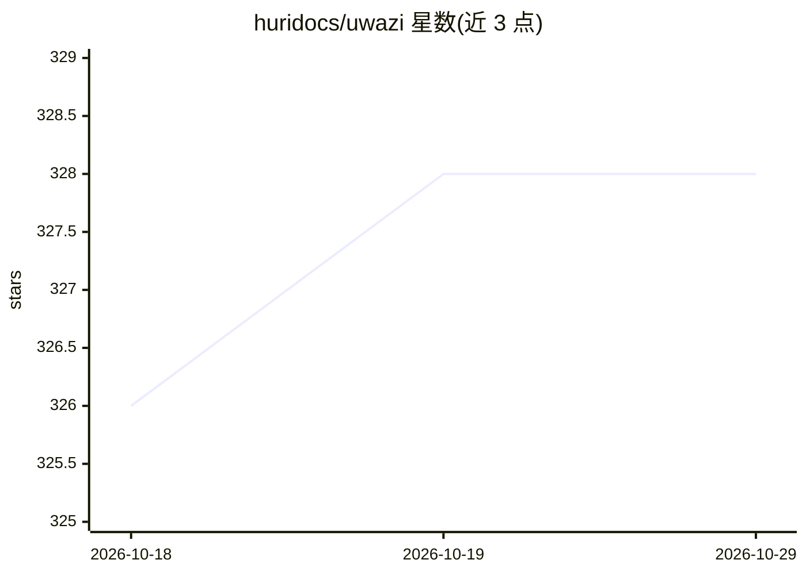

# huridocs/uwazi

⭐ 328 · TypeScript · MIT · 推送 2026-10-28 · [GitHub](https://github.com/huridocs/uwazi) · [官网](http://www.uwazi.io) · 组织维护

**面向人权组织的文档收藏管理与共享的 Web 数据库应用**

由 HURIDOCS 开发并维护的开源 Web 应用，用于采集、组织与共享信息集合，侧重文档（PDF）管理，支持数十家人权组织使用。技术栈为 Node.js + Yarn 4 + MongoDB（副本集）+ ElasticSearch + Poppler（pdftotext），基础设施依赖可通过 Docker Compose 启动，应用本体从源码构建运行。包含段落抽取（Information Extraction）等 AI 功能。最低硬件要求 4GB 内存、2 核、20GB 磁盘。

## 筛选速览

| 维度 | 判定 | 备注 |
|---|---|---|
| AI 角色 | `ai-enhanced` | 去掉 AI 部分产品仍成立 |
| 许可风险 | `permissive` | MIT |
| 部署形态 | `self-host` | docker 或自建部署 |
| 模型依赖 | — | README 未给出锁定关系 |
| 硬件要求 | — | 无带数字的原话,不猜 |
| 安装摩擦 | `low` | 无编译、无系统依赖或容器化 |
| 成熟度 | — | 结构信号不足 |

## 能力要点

- 以文档管理为核心的信息集合采集与组织
- ElasticSearch 全文检索 + MongoDB 副本集存储
- Information Extraction / 段落抽取功能（依赖外部服务）
- 基础设施依赖可用 Docker Compose 一键启动

## 适用场景

- 人权组织建立并共享文档与证据收藏库
- 对 PDF 等文档做全文检索与结构化管理
- 团队内部部署（on-prem）运行文档数据库

## 场景标签

`知识库管理` `文档解析` · 领域:知识与检索

## 证据(README 行号)

> L7: Uwazi is a flexible database application to capture and organise collections of information with a particular focus 
> L175: $ EXTERNAL_SERVICES=true FEATURE_FLAG_PARAGRAPH_EXTRACTION=true PARAGRAPH_EXTRACTION_URL=http://localhost:5051 DAT

## 星数曲线

2026-10-18 326 → 2026-10-29 328（+2）

---
*卡片 v1 · prompt 1.4 · 生成 2026-10-21 · 置信度 mid · 依据 README sha `240b7f812bf7` · [字段定义](../../DATASET.md)*
