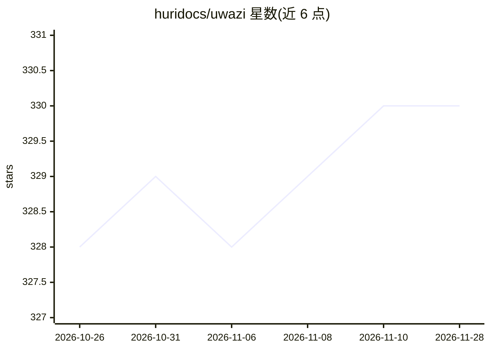

# huridocs/uwazi

⭐ 330 · TypeScript · MIT · 推送 2026-11-27 · [GitHub](https://github.com/huridocs/uwazi) · [官网](http://www.uwazi.io) · 组织维护

**面向人权组织的文档馆藏管理与发布 Web 应用**

HURIDOCS 发起的灵活数据库应用，用于采集和组织信息集合，重点面向文档管理，已被全球数十个人权组织使用。技术栈为 Node.js + MongoDB（副本集）+ ElasticSearch 全文检索，依赖 pdftotext 处理 PDF、Redis 与 Minio 存储可经 Docker Compose 启动。提供生产安装流程与开发环境（git clone + yarn）、Storybook、Jest/Cypress/Puppeteer 测试体系，并给出内存、CPU、磁盘的最低硬件要求。

## 筛选速览

| 维度 | 判定 | 备注 |
|---|---|---|
| AI 角色 | `ai-enhanced` | 去掉 AI 部分产品仍成立 |
| 许可风险 | `permissive` | MIT |
| 部署形态 | `self-host` | docker 或自建部署 |
| 模型依赖 | — | README 未给出锁定关系 |
| 硬件要求 | — | 无带数字的原话,不猜 |
| 安装摩擦 | `low` | 无编译、无系统依赖或容器化 |
| 成熟度 | — | 结构信号不足 |

## 能力要点

- 文档集合的采集、组织与全文检索（ElasticSearch）
- PDF 处理（pdftotext/Poppler）与多格式缩略图生成
- Docker Compose 一键启动基础设施依赖
- 面向人权组织的非营利场景支持

## 适用场景

- 为人权组织搭建可检索的文档馆藏站点
- 组织与分享大量 PDF 及多媒体资料
- 本地（on-prem）部署托管文档数据库

## 场景标签

 · 领域:文档管理/知识库

## 证据(README 行号)

> L7: Uwazi is a flexible database application to capture and organise collections of information with a particular focus 
> L24: - **ElasticSearch 8.18.0** Please note that ElasticSearch requires Java. Follow the instructions to install the pac
> L171: Cypress tests that use our Information Extraction features need to run Uwazi together with a dummy service that mi

## 星数曲线

2026-10-26 328 → 2026-11-28 330（+2）

---
*卡片 v1 · prompt 1.4 · 生成 2026-11-25 · 置信度 mid · 依据 README sha `cfbc7ca1617b` · [字段定义](../../DATASET.md)*
