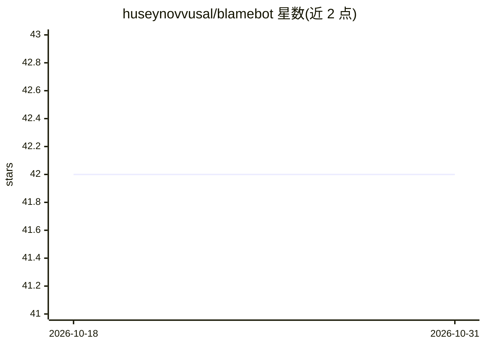

# huseynovvusal/blamebot

⭐ 42 · TypeScript · MIT · 推送 2026-05-04 · [GitHub](https://github.com/huseynovvusal/blamebot) · [官网](https://blamebot.huseynovvusal.dev) · 个人维护

**值班 AI agent：检测部署失败、定位根因责任人并自动回滚**

面向 DevOps/SRE 场景的自主值守 agent 应用：接入 Vercel、Sentry、UptimeRobot 的 webhook 告警，归一化为标准事件后从 GitHub 拉取提交与变更文件，按 glob 规则匹配责任人，用 Claude Sonnet 生成根因、影响范围与建议动作，经 Slack Block Kit 卡片推送并支持一键/自动回滚（Vercel API）。附带仪表盘、MTTR 与开发者可靠性分析、自然语言改配置、AI 事后报告生成。基于 Next.js + Upstash Redis 构建，Vercel Zero to Agent Hackathon 单人参赛作品，部署在 Vercel。

## 筛选速览

| 维度 | 判定 | 备注 |
|---|---|---|
| AI 角色 | `ai-native` | 本体是模型或模型工具 |
| 许可风险 | `permissive` | MIT |
| 部署形态 | `library` | 以包/库形式分发 |
| 模型依赖 | locked-api |  |
| 硬件要求 | — | 无带数字的原话,不猜 |
| 安装摩擦 | `low` | 无编译、无系统依赖或容器化 |
| 成熟度 | — | 结构信号不足 |

## 能力要点

- 告警→GitHub 取证→责任人匹配→AI 报告→Slack 通知的自动化流水线
- Autopilot 模式可按严重度阈值经 Vercel API 自动回滚，无需人工介入
- 基于 Redis 的同文件近 30 天相似事件检测与升级策略
- AI 生成事后报告（postmortem）与自然语言修改配置

## 适用场景

- 值班团队在部署失败时自动收到含根因分析的责任人定向通知
- 通过 Slack 按钮确认、回滚或起草热修 PR
- 跟踪 MTTR、开发者可靠性评分与服务健康趋势

## 场景标签

`工作流自动化` · 领域:效率与自动化

## 证据(README 行号)

> L13: BlameBot is an autonomous on-call agent that closes the loop from deploy failure to resolved incident — without wak
> L58: |**AI Report**|Claude Sonnet generates root cause, blast radius, recommended action|
> L104: When enabled, BlameBot can automatically roll back a failing deployment via the Vercel API without any human inter

## 星数曲线

2026-10-18 42 → 2026-10-31 42（+0）

---
*卡片 v1 · prompt 1.4 · 生成 2026-10-25 · 置信度 mid · 依据 README sha `bce6eb8e4042` · [字段定义](../../DATASET.md)*
