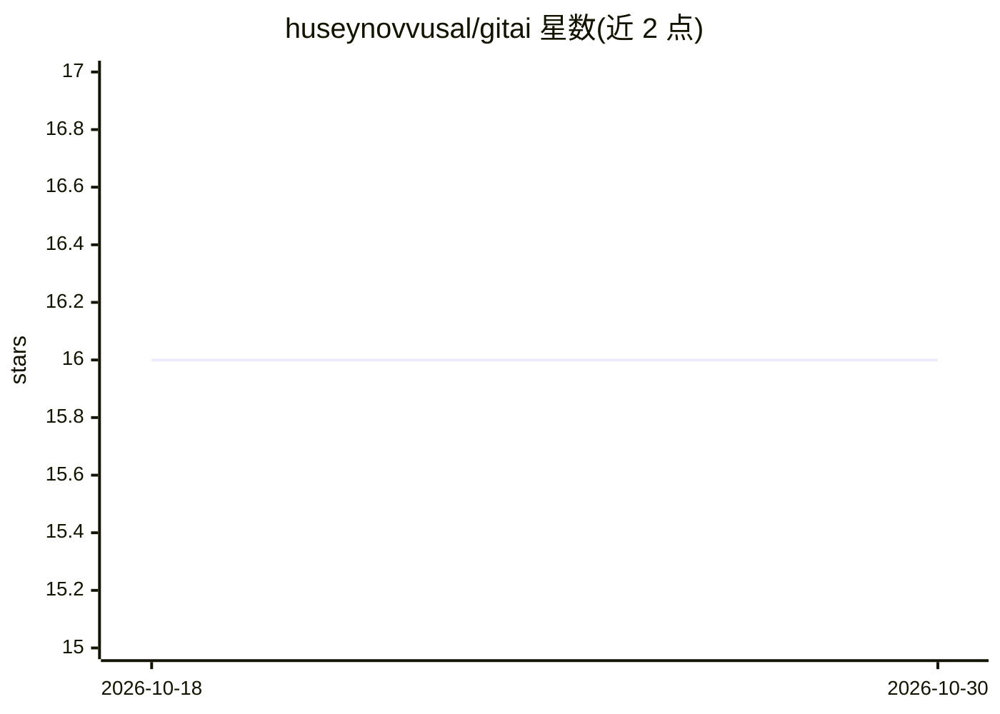

# huseynovvusal/gitai

⭐ 16 · Go · MIT · 推送 2025-12-26 · [GitHub](https://github.com/huseynovvusal/gitai) · 个人维护

**Go 编写的 CLI，用 AI 生成 git commit 信息**

面向开发者的开源终端工具：读取 git status 与 diff，经交互式 TUI 选择文件后调用 AI 后端生成提交信息建议，支持就地编辑与按键重新生成。后端可插拔，支持 OpenAI、Google Gemini（genai/gemini cli）及本地 Ollama。配置经 Viper 管理，支持 flag/环境变量/配置文件多级覆盖。以 Go 单二进制分发，通过 make build/install 构建安装。需注意：使用远端后端时 diff 与仓库内容会被发送给第三方服务，离线场景可用 Ollama。

## 筛选速览

| 维度 | 判定 | 备注 |
|---|---|---|
| AI 角色 | `ai-native` | 本体是模型或模型工具 |
| 许可风险 | `permissive` | MIT |
| 部署形态 | `None` |  |
| 模型依赖 | local-ok | 支持本地模型 |
| 硬件要求 | — | 无带数字的原话,不猜 |
| 安装摩擦 | `medium` | 含编译或系统依赖之一 |
| 成熟度 | — | 结构信号不足 |

## 能力要点

- 基于 diff + status 生成提交信息建议
- 可插拔后端：OpenAI、Google GenAI、Ollama（本地）
- 交互式 TUI 选择文件、编辑与重新生成建议
- Go 单二进制分发，make install 安装到 /usr/local/bin

## 适用场景

- 不想手写 commit message 时让 AI 依据 diff 生成
- 通过 pre-commit 钩子或 CI 辅助提交信息流程
- 用本地 Ollama 跑离线工作流避免代码外发

## 场景标签

`代码生成` · 领域:编码与开发

## 证据(README 行号)

> L3: Gitai is an open-source CLI tool that helps developers generate **high-quality git commit messages** using AI. It in
> L9: The project supports multiple AI backends (OpenAI, Google Gemini via genai, and local models via Ollama) and is inte

## 星数曲线

2026-10-18 16 → 2026-10-30 16（+0）

---
*卡片 v1 · prompt 1.4 · 生成 2026-10-30 · 置信度 high · 依据 README sha `66f37dc5d943` · [字段定义](../../DATASET.md)*
