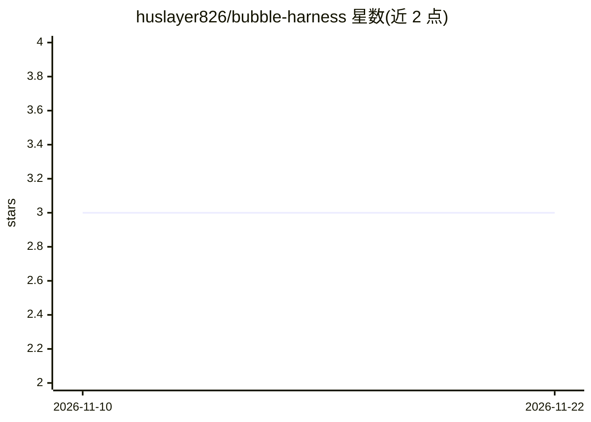

# huslayer826/bubble-harness

⭐ — · [GitHub]() · 组织维护

**给开发者的桌面端，集中运行多个编码 agent**

基于 Rust 与 Tauri 的 macOS 原生桌面应用，用于并排运行用户已订阅的编码 agent（Claude Code、Codex、Cursor、OpenCode、Grok、Antigravity），通过各 agent 自带的命令行工具登录，不代售 token、不要求 API key。内置 Git worktree 隔离的多 agent 竞速、diff 查看、checkpoint 回退与终端；窗口关闭后运行中的任务继续执行。仅支持 Apple Silicon Mac（macOS 11+），仓库不含源码，仅承载发布、网站、变更日志与 issue 跟踪。

## 筛选速览

| 维度 | 判定 | 备注 |
|---|---|---|
| AI 角色 | `ai-ecosystem` | LLM/agent 周边工具 |
| 许可风险 | `none` | — |
| 部署形态 | `desktop` | 安装包/桌面程序 |
| 模型依赖 | — | README 未给出锁定关系 |
| 硬件要求 | — | 无带数字的原话,不猜 |
| 安装摩擦 | `low` | 无编译、无系统依赖或容器化 |
| 成熟度 | `idea` | |

## 能力要点

- 一个窗口并排运行多个已订阅的编码 agent
- 每个 agent 独立 Git worktree，可一提示多 agent 竞速
- 窗口关闭后运行中的回合、审批与排队提示仍继续
- 存储、进程、Git 与终端在 Rust 原生进程中运行

## 适用场景

- 在同一界面里管理我已付费的多个编码 agent
- 把同一个提示发给多个 agent 对比结果
- 关闭窗口后让长任务继续跑，回来查看进展

## 场景标签

`多智能体` `编码 Agent` · 领域:Agent 开发

## 证据(README 行号)

> L6:  A native desktop app for running Claude Code, Codex, Cursor, OpenCode, Grok and Antigravity side by side.
> L41: Bubble checks which agents are installed and signed in when you first open it. Your logins stay on your Mac, and Bu

## 星数曲线

2026-11-10 3 → 2026-11-22 3（+0）

---
*卡片 v1 · prompt 1.4 · 生成 2026-11-21 · 置信度 high · 依据 README sha `0436a696c3d4` · [字段定义](../../DATASET.md)*
