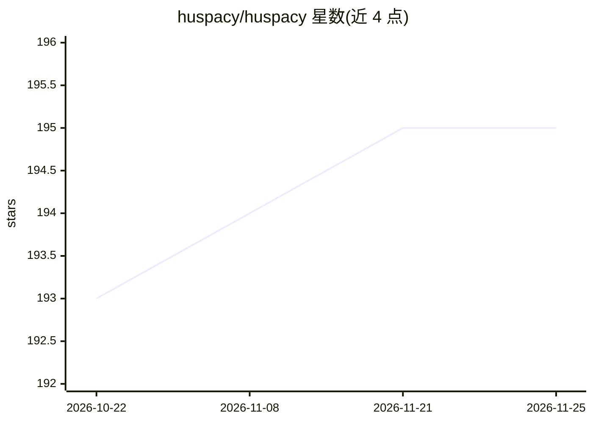

# huspacy/huspacy

⭐ 195 · Python · Apache-2.0 · 推送 2026-11-16 · [GitHub](https://github.com/huspacy/huspacy) · [官网](https://huspacy.github.io) · 组织维护

**面向开发者的匈牙利语工业级 spaCy NLP 流水线**

基于 spaCy 的匈牙利语处理工具：发布多个预训练流水线，组件覆盖分词、分句、词形还原、词性标注与形态特征、依存句法分析和命名实体识别，并通过 spaCy API 提供词/短语嵌入。提供 CPU 优化的 CNN 模型（md/lg）、基于 huBERT/XLM-R 的 transformer 模型（trf/trf_xl，建议 GPU）。模型发布至 Hugging Face Hub 与 PyPI，兼容 spaCy API，提供在线演示与 API 文档。由 SzegedAI 团队在 MILAB 项目下开发，Apache 2.0 许可。

## 筛选速览

| 维度 | 判定 | 备注 |
|---|---|---|
| AI 角色 | `ai-native` | 本体是模型或模型工具 |
| 许可风险 | `permissive` | Apache-2.0 |
| 部署形态 | `library` | 以包/库形式分发 |
| 模型依赖 | — | README 未给出锁定关系 |
| 硬件要求 | — | 无带数字的原话,不猜 |
| 安装摩擦 | `medium` | 含编译或系统依赖之一 |
| 成熟度 | — | 结构信号不足 |

## 能力要点

- 流水线组件：分词、分句、词形还原、标注、依存解析、NER
- 提供 CPU 优化模型与 GPU 优化的 transformer 模型（huBERT/XLM-R）
- 完全兼容 spaCy API，模型可经 huspacy.download 或 pip/uv 直接安装
- 提供在线演示，模型发布于 Hugging Face Hub

## 适用场景

- 对匈牙利语文本做分词、词形还原与句法分析
- 匈牙利语命名实体识别任务
- 需要嵌入向量的匈牙利语文本处理管线

## 场景标签

 · 领域:自然语言处理/多语言模型

## 证据(README 行号)

> L19: HuSpaCy is a spaCy library providing industrial-strength Hungarian language processing facilities through spaCy mod
> L20: The released pipelines consist of a tokenizer, sentence splitter, lemmatizer, tagger (predicting morphological feat

## 星数曲线

2026-10-22 193 → 2026-11-25 195（+2）

---
*卡片 v1 · prompt 1.4 · 生成 2026-11-25 · 置信度 high · 依据 README sha `58be871ec594` · [字段定义](../../DATASET.md)*
