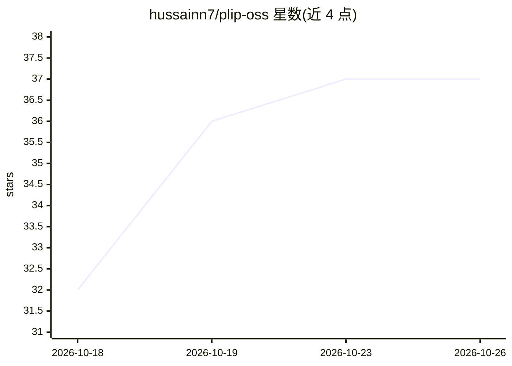

# hussainn7/plip-oss

⭐ 37 · Python · MIT · 推送 2026-10-22 · [GitHub](https://github.com/hussainn7/plip-oss) · 个人维护

**驻留 MacBook 刘海区的语音 AI 屏幕助手，指位与代操作**

macOS 上的常驻语音助手：按住快捷键口述提问，读取屏幕截图与控件文本地图，以动效指出点击位置、执行整理桌面/查找文件/系统设置等操作，操作前确认并支持 undo。AI 后端由用户自带（Claude/ChatGPT/Cursor/Gemini 或 Google 免费 key），Plip 本身以只读沙箱方式运行模型、由自己执行动作。本地保存记忆与历史，Analytics 默认开启可用环境变量关闭。以签名 dmg 或源码脚本安装。

## 筛选速览

| 维度 | 判定 | 备注 |
|---|---|---|
| AI 角色 | `ai-native` | 本体是模型或模型工具 |
| 许可风险 | `permissive` | MIT |
| 部署形态 | `desktop` | 安装包/桌面程序 |
| 模型依赖 | — | README 未给出锁定关系 |
| 硬件要求 | — | 无带数字的原话,不猜 |
| 安装摩擦 | `low` | 无编译、无系统依赖或容器化 |
| 成熟度 | — | 结构信号不足 |

## 能力要点

- 自带 AI 计划（Claude/ChatGPT/Cursor/Gemini）即可使用，含 Google 免费通道
- 屏幕地图列出真实控件位置，模型指向存在的元素，纯文本后端也可指位
- 动作由 Plip 自行执行（open/Spotlight/AppleScript/Shortcuts/Accessibility），带超时与 undo 历史
- 本地记忆面板支持从 Contacts/浏览器自动填充/邮件导入

## 适用场景

- 口述提问让 AI 指出某功能在屏幕上点哪里
- 让助手代为整理桌面、找文件、设置提醒等杂务
- 用已付费的 AI 订阅在 Mac 上获得带屏幕感知的助手

## 场景标签

`GUI 自动化` `AI 助手` · 领域:效率与自动化

## 证据(README 行号)

> L6:  Hold control + option and ask out loud. Plip looks at your screen,
> L74: |**Screen Recording**|Takes screenshots when you let go of the keys, so your AI sees what you see. Plip's own windo

## 星数曲线

2026-10-18 32 → 2026-10-26 37（+5）

---
*卡片 v1 · prompt 1.4 · 生成 2026-10-25 · 置信度 mid · 依据 README sha `1d49ee95e561` · [字段定义](../../DATASET.md)*
