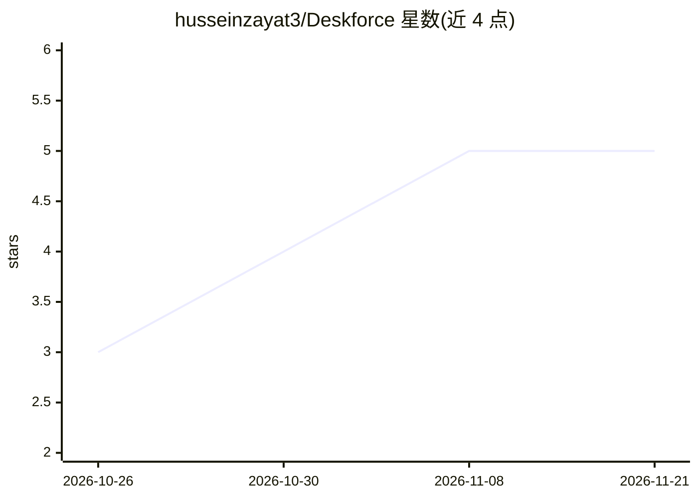

# husseinzayat3/Deskforce

⭐ 5 · TypeScript · MIT · 推送 2026-11-17 · [GitHub](https://github.com/husseinzayat3/Deskforce) · [官网](https://husseinzayat.it) · 个人维护

**AI 员工虚拟办公室桌面应用：CEO 规划并委派团队完成任务**

Electron 桌面应用（另有 Docker 镜像）：用户雇佣一组 AI 员工，向 CEO 提出目标，由 CEO 生成带成本估算的计划、经批准后逐级委派给下属执行。每个 agent 通过工具读写项目文件、搜索网页、向上汇报，每项任务以 git commit 记录可一键回滚；提供任务预算、月度消费上限、按员工/模型的支出统计、Slack 集成与平面图上的实时输出展示。支持接入多家 LLM 提供商及本地模型；未配置 key 时以 mock 文本回答以便先探索界面。

## 筛选速览

| 维度 | 判定 | 备注 |
|---|---|---|
| AI 角色 | `ai-native` | 本体是模型或模型工具 |
| 许可风险 | `permissive` | MIT |
| 部署形态 | `desktop` | 安装包/桌面程序 |
| 模型依赖 | local-ok | 支持本地模型 |
| 硬件要求 | — | 无带数字的原话,不猜 |
| 安装摩擦 | `low` | 无编译、无系统依赖或容器化 |
| 成熟度 | — | 结构信号不足 |

## 能力要点

- CEO 规划带成本估算的计划，批准后才会执行
- 每项任务是一次 git commit，可一键回滚
- 按任务预算、月度上限与员工/模型维度的支出控制
- 支持 Slack 下达任务、查看进度与批准计划

## 适用场景

- 给 CEO agent 一个目标，让它规划并委派团队构建网站等项目
- 在不同员工上分配强弱模型以控制成本
- 通过 Slack 向 agent 团队下达工作并审批计划
- 用本地 Ollama 模型让数据不出本机

## 场景标签

`Agent 框架` `多智能体` `编码 Agent` · 领域:Agent 开发

## 证据(README 行号)

> L3: **A virtual office of AI agents.** Hire a team, give the CEO a goal, and watch it get planned, delegated and built —
> L61: You give a request to your most senior employee. It plans the work, and once you approve, delegates parts to more j
> L76: |What it is|A desktop app (macOS, Windows, Linux) or a Docker image|Libraries for building agents into your own cod

## 星数曲线

2026-10-26 3 → 2026-11-21 5（+2）

---
*卡片 v1 · prompt 1.4 · 生成 2026-11-21 · 置信度 high · 依据 README sha `1094bdfd224b` · [字段定义](../../DATASET.md)*
