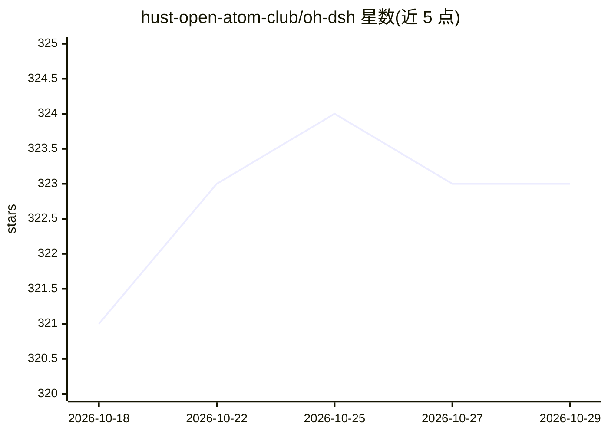

# hust-open-atom-club/oh-dsh

⭐ 323 · TypeScript · MIT · 推送 2026-09-12 · [GitHub](https://github.com/hust-open-atom-club/oh-dsh) · [官网](https://dsh.openatom.club/) · 组织维护 · 中文 README

**DSH runtime 发行版：Desktop/Web/TUI 三端本地 AI 开发工作台**

由华中科技大学开源原子俱乐部维护的 DeepSeek Harness（DSH）runtime 发行版，将 AI Agent、Node.js、本地开发工具与内置插件打包为 Desktop、Web 与 TUI 三种形态，用统一命令 ohdsh 启动，三端共享会话、凭据、皮肤与插件缓存。内置 Workspace、PTY 终端、浏览器、文件浏览、Git Review 与插件市场，每种发行自带固定版本的 DSH 与 Node runtime。图片输入由 DSH 原生多模态模型（如 DeepSeek V4 Flash）处理，无需额外视觉插件。MIT 许可，保留上游插件署名。

## 筛选速览

| 维度 | 判定 | 备注 |
|---|---|---|
| AI 角色 | `ai-ecosystem` | LLM/agent 周边工具 |
| 许可风险 | `permissive` | MIT |
| 部署形态 | `library` | 以包/库形式分发 |
| 模型依赖 | locked-api |  |
| 硬件要求 | — | 无带数字的原话,不猜 |
| 安装摩擦 | `low` | 无编译、无系统依赖或容器化 |
| 成熟度 | — | 结构信号不足 |

## 能力要点

- 同一 ohdsh 命令启动 Desktop/Web/TUI，三端共享会话与插件状态
- 内置 Workspace、PTY 终端、Git Review 与插件市场
- 按需安装完整版/Web-only/TUI-only，自带 Node runtime
- 原生 attachment rail 处理图片输入，无需额外视觉插件

## 适用场景

- 在本地统一界面中使用 AI Agent 进行开发工作
- SSH 或纯终端环境用 TUI 运行 DSH 工作台
- 在浏览器或服务器上以 Web 形态运行轻量版工作台
- 通过插件市场扩展 Git Review、侧边栏等能力

## 场景标签

`编码 Agent` · 领域:编码与开发

## 证据(README 行号)

> L6:  一套 DSH runtime，Desktop、Web 与 TUI 三种开发体验。
> L23: Oh-DSH 将 DeepSeek Harness、Node.js、本地开发工具和内置插件打包为可安装的
> L30:  使用同一个 <code>ohdsh</code> 命令启动 Desktop、Web 或 TUI。三端共享会话、凭据、皮肤与插件缓存，同时保留独立 Profile。

## 星数曲线

2026-10-18 321 → 2026-10-29 323（+2）

---
*卡片 v1 · prompt 1.4 · 生成 2026-10-22 · 置信度 mid · 依据 README sha `8b823f90f732` · [字段定义](../../DATASET.md)*
