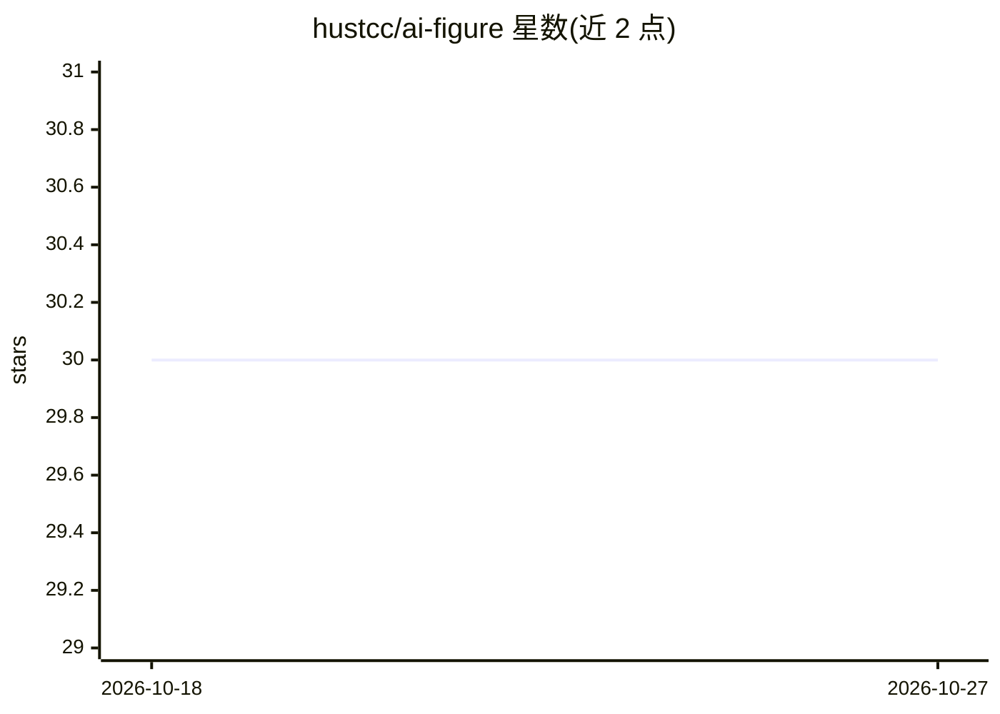

# hustcc/ai-figure

⭐ 30 · TypeScript · MIT · 推送 2026-06-11 · [GitHub](https://github.com/hustcc/ai-figure) · [官网](https://figure.ling.pub/gallery) · 个人维护

**面向开发者的 SVG 图表渲染库：定义配置即得 13 类图表**

纯 SVG 图表渲染库，单一 fig() 入口接受 JSON 配置或 Mermaid 类 markdown 字符串，输出自包含 SVG，浏览器与 Node.js 均可运行，零 DOM 依赖。支持 13 种图表类型（流程图、树、思维导图、架构图、时序图、四象限、甘特图、状态机、ER 图、时间线、泳道、气泡图、雷达图），自动布局，支持明暗主题与 9 套内置调色板。面向 AI agent 场景设计：输入流式安全（部分输入不抛错），并附带可被 Copilot、Cursor、Claude 等加载的 SKILL.md。限制：甘特图宽度固定 804px。

## 筛选速览

| 维度 | 判定 | 备注 |
|---|---|---|
| AI 角色 | `ai-ecosystem` | LLM/agent 周边工具 |
| 许可风险 | `permissive` | MIT |
| 部署形态 | `library` | 以包/库形式分发 |
| 模型依赖 | — | README 未给出锁定关系 |
| 硬件要求 | — | 无带数字的原话,不猜 |
| 安装摩擦 | `low` | 无编译、无系统依赖或容器化 |
| 成熟度 | — | 结构信号不足 |

## 能力要点

- 单一 fig() 入口接受 markdown 或 JSON，返回自包含 SVG 字符串
- 13 种图表类型，自动布局，零 DOM 依赖，浏览器与 Node.js 通用
- 输入流式安全：部分输入不抛错，返回合法空 SVG
- 附带 SKILL.md 供 AI agent（Copilot/Cursor/Claude 等）加载为上下文

## 适用场景

- 在我的 agent/应用中以编程方式生成流程图、时序图等图表
- 让 AI 助手根据自然语言产出结构化图表配置并渲染
- 在文档或技术方案中嵌入架构图与甘特图

## 场景标签

 · 领域:可视化/图表库

## 证据(README 行号)

> L52: - 🤖 **AI-friendly** — single `fig()` entry point accepts a markdown string **or** a JSON config; streaming-safe (pa
> L53: - 📊 **13 diagram types** — flowchart, tree, mindmap, architecture, sequence, quadrant, Gantt, state machine, ER dat

## 星数曲线

2026-10-18 30 → 2026-10-27 30（+0）

---
*卡片 v1 · prompt 1.4 · 生成 2026-10-26 · 置信度 high · 依据 README sha `a5cdc5e54b40` · [字段定义](../../DATASET.md)*
