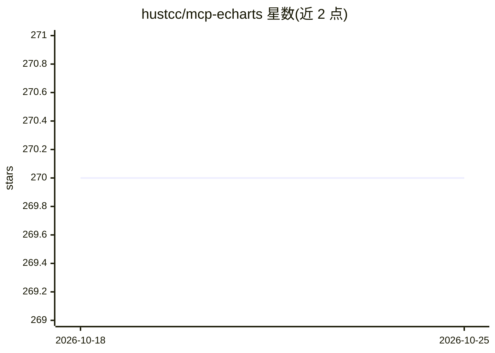

# hustcc/mcp-echarts

⭐ 270 · TypeScript · MIT · 推送 2026-08-27 · [GitHub](https://github.com/hustcc/mcp-echarts) · [官网](https://github.com/hustcc/mcp-echarts) · 个人维护

**通过 MCP 让 AI 动态生成 ECharts 图表的 MCP 服务器**

面向 MCP 客户端（Claude、VSCode、Cline、Cherry Studio 等）的图表生成服务器：支持 ECharts 全部特性与语法，可导出 png/svg/option 格式并带语法校验以支持模型多轮输出；支持 stdio、SSE 与 Streamable HTTP 三种传输方式。图表全部在本地生成，不依赖远程服务，声明零依赖安装；可选配置 MinIO/S3/OSS 等对象存储以 URL 替代 Base64 输出，未配置时自动回退 Base64。需要 Node.js 18 及以上。

## 筛选速览

| 维度 | 判定 | 备注 |
|---|---|---|
| AI 角色 | `ai-ecosystem` | LLM/agent 周边工具 |
| 许可风险 | `permissive` | MIT |
| 部署形态 | `library` | 以包/库形式分发 |
| 模型依赖 | — | README 未给出锁定关系 |
| 硬件要求 | — | 无带数字的原话,不猜 |
| 安装摩擦 | `low` | 无编译、无系统依赖或容器化 |
| 成熟度 | — | 结构信号不足 |

## 能力要点

- 支持 ECharts 全部特性与语法，导出 png/svg/option 并带校验
- stdio / SSE / Streamable HTTP 三种传输方式
- 本地生成，不依赖远程服务，零依赖安装
- 可选 MinIO/S3/OSS/Azure/GCS/COS 对象存储，未配置自动回退 Base64

## 适用场景

- 在 Claude、VSCode、Cline 等桌面应用中让 AI 生成图表
- 数据分析时通过 AI 输出 ECharts 可视化
- 通过 SSE/HTTP 协议在 modelsope、glama.ai 等平台使用

## 场景标签

`数据分析` · 领域:效率与自动化

## 证据(README 行号)

> L3: Generate Apache ECharts with AI MCP dynamically for chart generation and data analysis. _Also you can use mcp-server
> L25: To use with `Desktop APP`, such as Claude, VSCode, Cline, Cherry Studio, and so on, add the MCP server config below

## 星数曲线

2026-10-18 270 → 2026-10-25 270（+0）

---
*卡片 v1 · prompt 1.4 · 生成 2026-10-22 · 置信度 high · 依据 README sha `1bd01803311c` · [字段定义](../../DATASET.md)*
