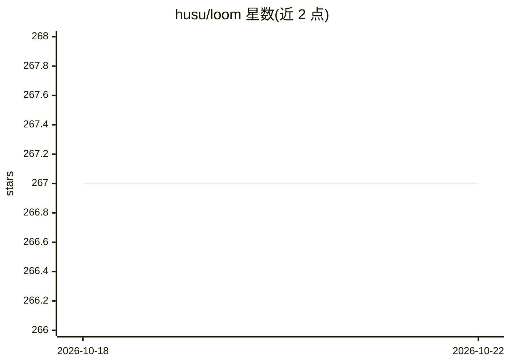

# husu/loom

⭐ 267 · 推送 2026-05-28 · [GitHub](https://github.com/husu/loom) · [官网](https://loom.vegamo.cn) · 组织维护 · 中文 README

**用对话生成 JSON Schema 接口文档的 CLI 工具，含浏览与 Mock**

面向开发者的 Node.js 命令行工具：通过 TUI 聊天界面与大模型（默认 DeepSeek，兼容 OpenAI 接口）对话生成和更新 JSON Schema 格式的 API 文档，支持通过 x-entity-ref 引用 docs/entities 中的可复用实体 Schema。附带 React SPA 文档浏览器和基于 JSON Schema 动态生成数据的 Mock 服务，可在 TUI 内或以 loom serve 组合启动。还提供 /scan 命令用 LLM 从源码识别 API 并生成 Schema（含断点续扫与缓存）。需配置 DeepSeek API Key，npm 全局安装。

## 筛选速览

| 维度 | 判定 | 备注 |
|---|---|---|
| AI 角色 | `ai-native` | 本体是模型或模型工具 |
| 许可风险 | `none` | — |
| 部署形态 | `library` | 以包/库形式分发 |
| 模型依赖 | locked-api |  |
| 硬件要求 | — | 无带数字的原话,不猜 |
| 安装摩擦 | `low` | 无编译、无系统依赖或容器化 |
| 成熟度 | — | 结构信号不足 |

## 能力要点

- TUI 对话生成/更新 JSON Schema API 文档
- React SPA 文档浏览器，类 Swagger 表格视图
- 基于 JSON Schema 动态生成 Mock 数据，支持 Mock.js 表达式与状态码 override
- /scan 命令用 LLM 从源码识别 API，带断点续扫与内容哈希缓存

## 适用场景

- 用自然语言描述接口，快速产出 API 文档
- 联调期间启动 Mock 服务模拟后端接口
- 从已有源码扫描识别接口并生成 Schema 文档

## 场景标签

 · 领域:开发工具/API 文档

## 证据(README 行号)

> L5: 基于 AI 的 JSON Schema 文档生成器，集成 TUI 交互、Web 浏览器与 Mock 服务
> L12: - **🤖 AI 驱动的 Schema 生成** —— 通过 TUI 聊天界面与大模型（DeepSeek、OpenAI）对话生成和更新 JSON Schema API 文档

## 星数曲线

2026-10-18 267 → 2026-10-22 267（+0）

---
*卡片 v1 · prompt 1.4 · 生成 2026-10-22 · 置信度 high · 依据 README sha `c4feab60ec23` · [字段定义](../../DATASET.md)*
