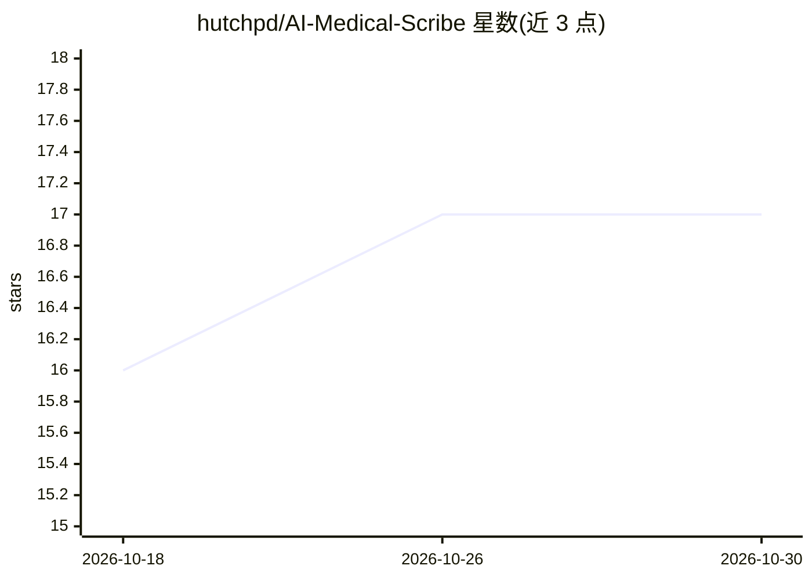

# hutchpd/AI-Medical-Scribe

⭐ 17 · JavaScript · MIT · 推送 2026-05-22 · [GitHub](https://github.com/hutchpd/AI-Medical-Scribe) · 个人维护

**浏览器内本地运行的 AI 医疗抄录原型，转录、摘要与 FHIR 导出**

单页浏览器原型应用，面向临床诊疗记录场景：用 Chrome 语音识别做实时问诊转录，用 Chrome 内置 Prompt API（Gemini Nano，Summarizer API 兜底）在设备端生成摘要、起草文档并抽取临床结构化信息（问题、用药、过敏等分桶）。带置信度高亮与审核模式、本地追加式审计日志、浏览器内 FHIR R4 文档 Bundle 导出（可 POST 到自配端点）、AES-GCM 加密存储与隐私控制。无后端、无 API key，数据默认不离设备；依赖仍在逐步推出的 Chrome 内置 AI 功能，移动浏览器不可用。

## 筛选速览

| 维度 | 判定 | 备注 |
|---|---|---|
| AI 角色 | `ai-native` | 本体是模型或模型工具 |
| 许可风险 | `permissive` | MIT |
| 部署形态 | `None` |  |
| 模型依赖 | — | README 未给出锁定关系 |
| 硬件要求 | `gpu-8g` | |
| 安装摩擦 | `low` | 无编译、无系统依赖或容器化 |
| 成熟度 | `idea` | |

## 能力要点

- Chrome 语音识别实时转录 + 内置 AI 设备端摘要与文档起草
- 结构化临床信息抽取（问题/用药/过敏/随访等分桶）
- 浏览器内 FHIR R4 Bundle 导出，支持直接 POST 到配置端点
- 置信度分级、审核模式、本地追加式审计日志与加密存储

## 适用场景

- 门诊问诊时本地转录并生成摘要与文档草稿
- 在无后端、数据不出设备的前提下导出 FHIR 结构化病历
- 医生用审核模式核验 AI 生成与抽取内容的可靠性

## 场景标签

`语音识别` `AI 写作` · 领域:内容生成

## 证据(README 行号)

> L5: AI Medical Scribe is a browser-based prototype for live consultation transcription, on-device summarisation, documen
> L23: - On-device AI summary generation after transcription stops.
> L172: Consultation summaries are generated on-device using Chrome's Prompt API when available, with Summarizer API fallb

## 星数曲线

2026-10-18 16 → 2026-10-30 17（+1）

---
*卡片 v1 · prompt 1.4 · 生成 2026-10-29 · 置信度 high · 依据 README sha `1f66be98d028` · [字段定义](../../DATASET.md)*
