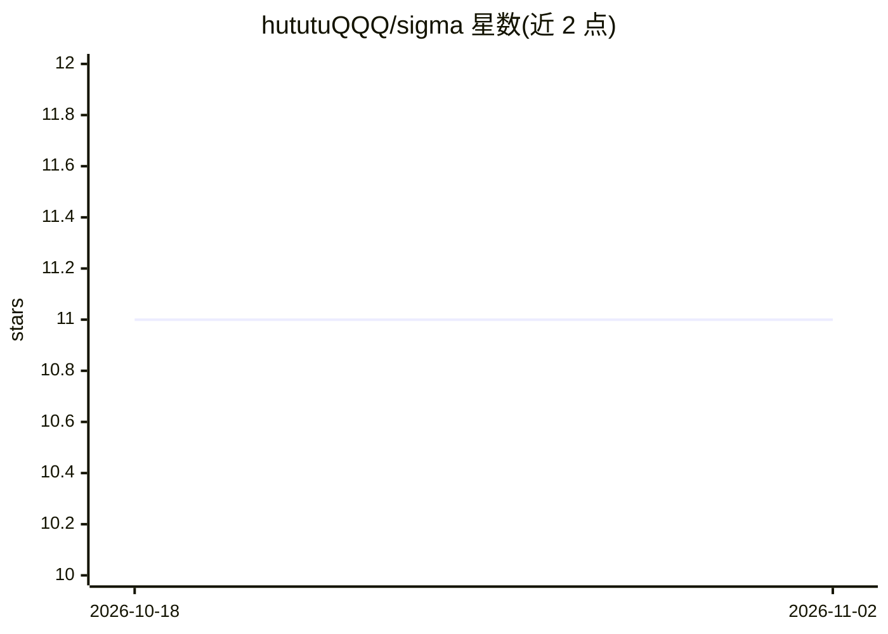

# hututuQQQ/sigma

⭐ 11 · TypeScript · MIT · 推送 2026-09-17 · [GitHub](https://github.com/hututuQQQ/sigma) · [官网](https://sigmacode.biz) · 个人维护 · 中文 README

**开源 AI 编程代理：沙箱执行长任务、断点恢复、证据化收尾**

面向编码任务的开源 AI agent：命令在强制的原生沙箱（Windows AppContainer / Linux namespace）内执行，完整会话（计划、模型轮次、工具回执、检查点）持久化，可在进程中断后恢复、回放与审计；变更工作须通过当前验证与所需审查证据才能收尾。仓库包含 Sigma Runtime、CLI、TUI 与 ACP v1 服务器，桌面/Web/移动客户端为独立下游。通过版本固定的 Pi 网关接入多家模型提供商，支持 MCP 服务器与子 agent 协调。Linux x64 稳定，Windows 为未签名预览版。

## 筛选速览

| 维度 | 判定 | 备注 |
|---|---|---|
| AI 角色 | `ai-native` | 本体是模型或模型工具 |
| 许可风险 | `permissive` | MIT |
| 部署形态 | `desktop` | 安装包/桌面程序 |
| 模型依赖 | — | README 未给出锁定关系 |
| 硬件要求 | — | 无带数字的原话,不猜 |
| 安装摩擦 | `low` | 无编译、无系统依赖或容器化 |
| 成熟度 | `idea` | |

## 能力要点

- 原生沙箱执行（AppContainer / Linux namespace），沙箱不健康则拒绝执行
- 持久化会话：中断后可恢复、回放、转向与审计
- 证据账本：模型叙述须经当前验证与审查证据方可完成变更
- CLI、TUI、桌面客户端共用同一事件溯源运行时（ACP v1）

## 适用场景

- 运行需要保留状态的长时间编码任务并在中断后续跑
- 在沙箱内让 agent 读写仓库、执行命令并留证据审计
- 通过桌面或 TUI 界面做有验证收尾的代码修改

## 场景标签

`编码 Agent` · 领域:编码与开发

## 证据(README 行号)

> L5:  The open-source coding agent that survives interruptions and proves its changes.
> L21: Sigma Code is built for coding tasks that must not lose their state or declare victory too early. Commands run insi
> L62: - Read and edit repositories, run commands, use LSP-backed code intelligence, and connect explicitly trusted MCP se

## 星数曲线

2026-10-18 11 → 2026-11-02 11（+0）

---
*卡片 v1 · prompt 1.4 · 生成 2026-11-02 · 置信度 mid · 依据 README sha `7a1cf51a6c0a` · [字段定义](../../DATASET.md)*
