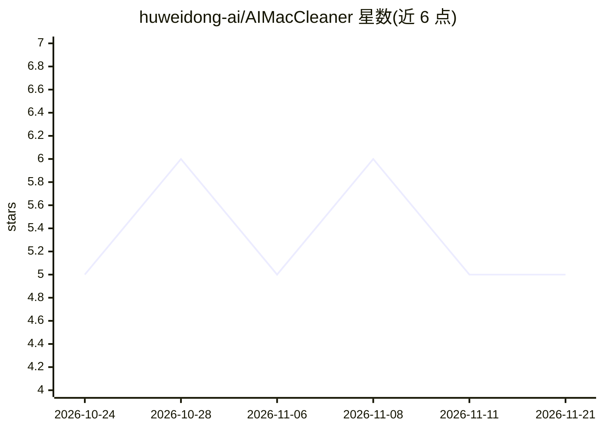

# huweidong-ai/AIMacCleaner

⭐ 5 · Swift · MIT · 推送 2026-11-20 · [GitHub](https://github.com/huweidong-ai/AIMacCleaner) · 个人维护 · 中文 README

**macOS 应用深度卸载与残留清理工具，内置 AI Agent**

开源 macOS 清理工具，核心是应用深度卸载：扫描 16 类目录（Homebrew、npm/pipx、沙盒容器、LaunchAgents、shell 配置、缓存、孤儿数据等），移除应用及其残留。用户数据进废纸篓可恢复，缓存与系统文件永久删除，系统路径受保护。AI 部分为内置 Agent（Ask AI）：自然语言描述目标后调用 12 个预定义只读或草稿级技能，输出清理计划，删除前需人工确认；支持配置 OpenAI/Anthropic/兼容 provider 的 API key。提供 DMG、源码构建与 CLI 三种使用方式。

## 筛选速览

| 维度 | 判定 | 备注 |
|---|---|---|
| AI 角色 | `ai-enhanced` | 去掉 AI 部分产品仍成立 |
| 许可风险 | `permissive` | MIT |
| 部署形态 | `desktop` | 安装包/桌面程序 |
| 模型依赖 | — | README 未给出锁定关系 |
| 硬件要求 | — | 无带数字的原话,不猜 |
| 安装摩擦 | `low` | 无编译、无系统依赖或容器化 |
| 成熟度 | — | 结构信号不足 |

## 能力要点

- 16 类扫描的深度卸载与孤儿残留检测
- 内置 Agent 调用 12 个技能（8 个只读，4 个仅改动草稿）
- AI Review 自动复核卸载清单并标注保留理由
- 进程管理器按端口定位并一键结束进程

## 适用场景

- 彻底卸载应用并清除包管理器安装的 CLI 工具残留
- 找回已删除应用遗留在 ~/Library 的孤儿数据
- 通过对话让 Agent 扫描并制定清理计划后确认执行
- 排查占用特定端口的进程

## 场景标签

 · 领域:系统工具/macOS 实用程序

## 证据(README 行号)

> L3: **The macOS uninstaller that actually removes everything.**
> L27: ### 🤖 AI Agent ("Ask AI")
> L28: Describe what you want in natural language — "uninstall Cursor completely" or "scan all leftovers" — and the built-

## 星数曲线

2026-10-24 5 → 2026-11-21 5（+0）

---
*卡片 v1 · prompt 1.4 · 生成 2026-11-21 · 置信度 high · 依据 README sha `dd590189770c` · [字段定义](../../DATASET.md)*
