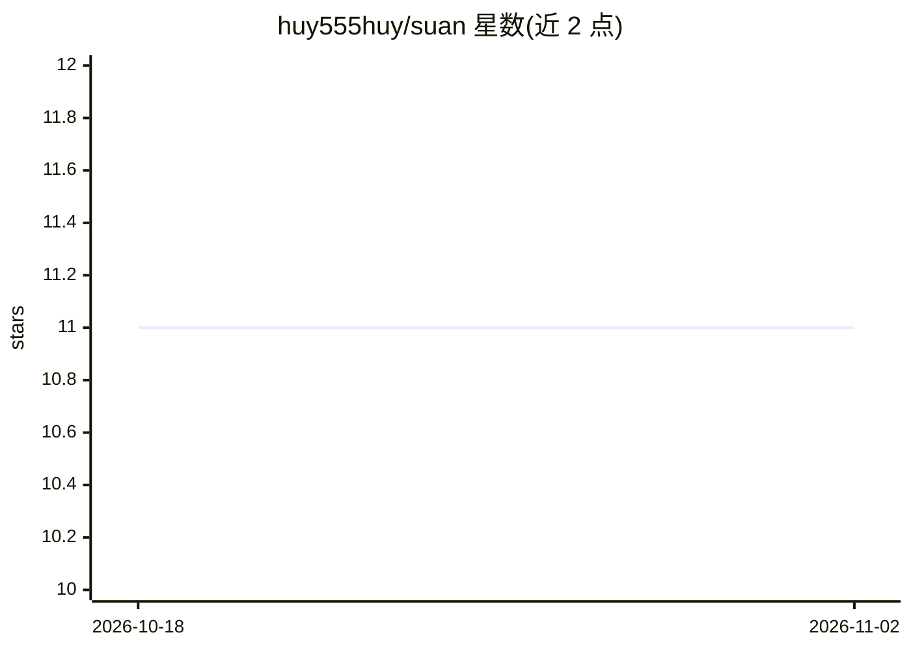

# huy555huy/suan

⭐ 11 · Python · 推送 2026-08-05 · [GitHub](https://github.com/huy555huy/suan) · 个人维护 · 中文 README

**中西命理 AI Agent：单 Agent ReAct 循环合参八字/紫微/占星/塔罗等七体系**

面向命理咨询用户的 AI Agent 应用：单个 LLM 在 ReAct 循环中自主决策，通过 9 个工具加载技能方法论、跑纯 Python 排盘（八字/紫微/易经/风水/占星/塔罗/数字命理）、用 ripgrep 检索 81 篇典籍与 61 条规则、读取专业盘例，并可主动向用户追问补充信息。后端基于 Fastapi 提供 SSE 事件流（思考过程、工具调用、流式文本），通过 OpenAI 兼容 API 接入 DeepSeek 等模型，需配置 API key 与安装 ripgrep 系统依赖。

## 筛选速览

| 维度 | 判定 | 备注 |
|---|---|---|
| AI 角色 | `ai-native` | 本体是模型或模型工具 |
| 许可风险 | `none` | — |
| 部署形态 | `library` | 以包/库形式分发 |
| 模型依赖 | — | README 未给出锁定关系 |
| 硬件要求 | — | 无带数字的原话,不猜 |
| 安装摩擦 | `low` | 无编译、无系统依赖或容器化 |
| 成熟度 | — | 结构信号不足 |

## 能力要点

- 单 Agent ReAct 循环，LLM 自主决定加载技能与交叉验证路径
- 9 个工具：排盘、典籍/规则 ripgrep 检索、盘例加载、主动追问等
- 覆盖八字/紫微/易经/风水/占星/塔罗/数字命理七套体系
- SSE 事件流输出思考过程、工具调用与流式文本

## 适用场景

- 输入出生信息获得多命理体系合参的排盘与研判
- 通过追问补充档案信息获得更完整的分析
- 查看 agent 思考与检索过程的可验证推理时间线

## 场景标签

`聊天机器人` · 领域:对话与助手

## 证据(README 行号)

> L19: **单 Agent ReAct 循环** — 一个 LLM 自主决定：加载哪些技能、算哪些盘、查哪些典籍、怎么交叉验证、什么时候输出。
> L38: |`compute_chart(type)`|跑纯 Python 排盘|

## 星数曲线

2026-10-18 11 → 2026-11-02 11（+0）

---
*卡片 v1 · prompt 1.4 · 生成 2026-11-02 · 置信度 high · 依据 README sha `a1521d911e69` · [字段定义](../../DATASET.md)*
