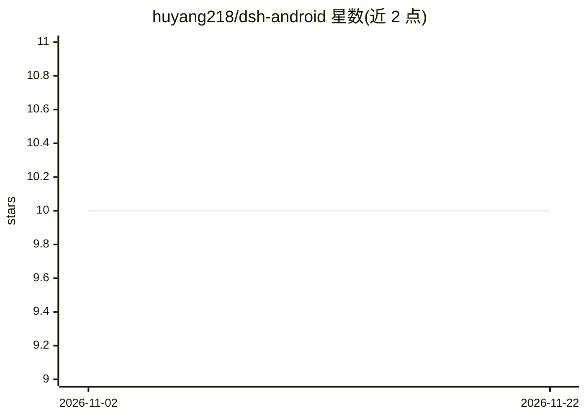

# huyang218/dsh-android

⭐ 10 · JavaScript · 推送 2026-08-23 · [GitHub](https://github.com/huyang218/dsh-android) · [官网](https://github.com/huyang218/dsh-android/releases/latest) · 个人维护 · 中文 README

**把 dsh host 与 client 一起装进 Android 手机独立运行**

DeepSeek Harness（dsh）的非官方 Android 应用：apk 内嵌 Node 二进制与 dsh 运行时快照，首次启动自行解包，前台服务拉起 host，WebView 内加载自写的 client 插件名册，host↔client 走进程内传输。与桌面版兄弟项目思路相同但不共享代码。形态决策上仅支持 Android、去掉 shell 能力面（不能执行命令，保留文件、会话、附件与对话），不上架商店、从 GitHub 直发 apk。目前仅模拟器验证，真机验证、Node 重编、进程守护尚未完成。

## 筛选速览

| 维度 | 判定 | 备注 |
|---|---|---|
| AI 角色 | `ai-native` | 本体是模型或模型工具 |
| 许可风险 | `none` | — |
| 部署形态 | `None` |  |
| 模型依赖 | locked-api |  |
| 硬件要求 | — | 无带数字的原话,不猜 |
| 安装摩擦 | `low` | 无编译、无系统依赖或容器化 |
| 成熟度 | `idea` | |

## 能力要点

- apk 内嵌 Node ≥22 运行时，无需服务器或另一台电脑
- 进程内 host↔client 传输，不依赖网络连接
- 移动端布局以独立 client 插件包（packages/mobile-layout/）实现
- 去除 subprocess 编排行以去掉 shell 能力面

## 适用场景

- 在 Android 手机上独立运行 dsh 会话与对话
- 无电脑在场时在手机上读写文件并与模型交互
- 参与 dsh 移动端 client 插件的开发

## 场景标签

`AI 助手` · 领域:对话与助手

## 证据(README 行号)

> L5: DeepSeek Harness(`dsh`)的 Android 应用:把 dsh 的 host 和 client **一起装进手机**,不连任何服务器,也不依赖任何一台开着的电脑。
> L24: |**agent 能力面**|**没有 shell**|`node-pty` 是 `@deepseek-ai/dsh-subprocess-local` 的顶层静态 import,而 `subprocess` 是 `dsh-bas

## 星数曲线

2026-11-02 10 → 2026-11-22 10（+0）

---
*卡片 v1 · prompt 1.4 · 生成 2026-11-19 · 置信度 high · 依据 README sha `e20295dac003` · [字段定义](../../DATASET.md)*
