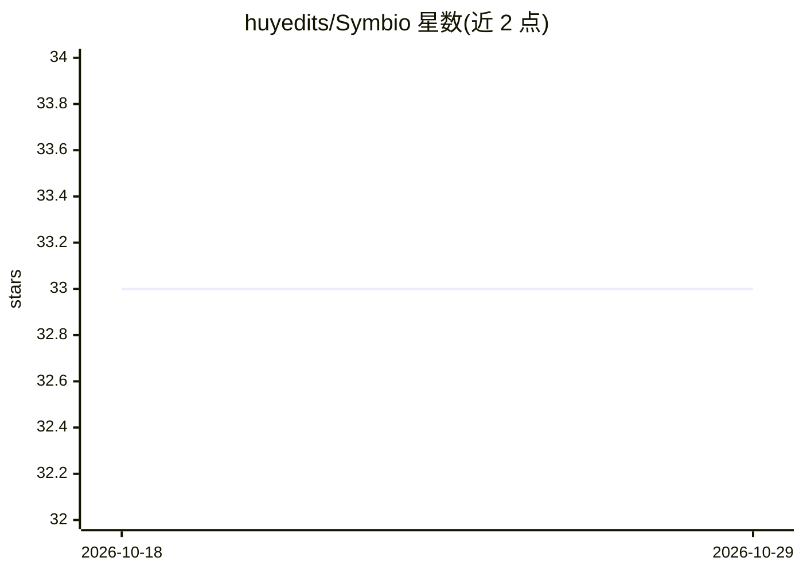

# huyedits/Symbio

⭐ 33 · Python · Apache-2.0 · 推送 2026-10-28 · [GitHub](https://github.com/huyedits/Symbio) · 个人维护

**Mac 本地自微调 AI agent：从纠错中学习并回滚变差的 LoRA**

面向 Mac 用户的本地 AI agent，围绕 MLX 本地模型运行，无云端推理。核心机制：自动收集用户纠错与工具失败后的成功恢复作为训练数据，积累后执行小规模 LoRA 微调并热加载适配器；以 golden set 做回归评估，变差则自动回滚。附带可学习技能（Markdown 流程训练专用 worker 适配器）、本地记忆与 RAG、网页研究、浏览器与 macOS 无障碍 API 桌面控制、Telegram 网关、Mixture of Agents、权限门控，以及训练过程可视化桌面宠物。仅支持 macOS。

## 筛选速览

| 维度 | 判定 | 备注 |
|---|---|---|
| AI 角色 | `ai-native` | 本体是模型或模型工具 |
| 许可风险 | `permissive` | Apache-2.0 |
| 部署形态 | `library` | 以包/库形式分发 |
| 模型依赖 | — | README 未给出锁定关系 |
| 硬件要求 | — | 无带数字的原话,不猜 |
| 安装摩擦 | `medium` | 含编译或系统依赖之一 |
| 成熟度 | `idea` | |

## 能力要点

- 纠错与工具恢复自动转为训练数据并执行 LoRA 微调，基座模型冻结
- golden set 回归保护：变差的微调自动回滚
- 通过 macOS 无障碍 API 读取窗口控件树执行桌面操作，无需视觉模型
- LoRA 训练过程以桌面宠物实时可视化（鱼干=训练步、尾巴=loss）

## 适用场景

- 让常驻本机的 agent 从我的纠错中持续学习而不膨胀系统提示词
- 在 Mac 上自动完成浏览、桌面操作、笔记与研究等任务
- 通过 Telegram 从手机使用本地实例

## 场景标签

`微调` `GUI 自动化` `浏览器自动化` · 领域:效率与自动化

## 证据(README 行号)

> L35: Corrections and successful tool recoveries are automatically collected as training examples. Once enough examples a
> L5: > Runs on your Mac. Remembers what matters. Learns new skills. Fine-tunes itself with LoRA. No cloud inference. No s
> L64: * **No API required for inference** — the default architecture is designed around local models.

## 星数曲线

2026-10-18 33 → 2026-10-29 33（+0）

---
*卡片 v1 · prompt 1.4 · 生成 2026-10-25 · 置信度 high · 依据 README sha `fb62ef5ca2dc` · [字段定义](../../DATASET.md)*
