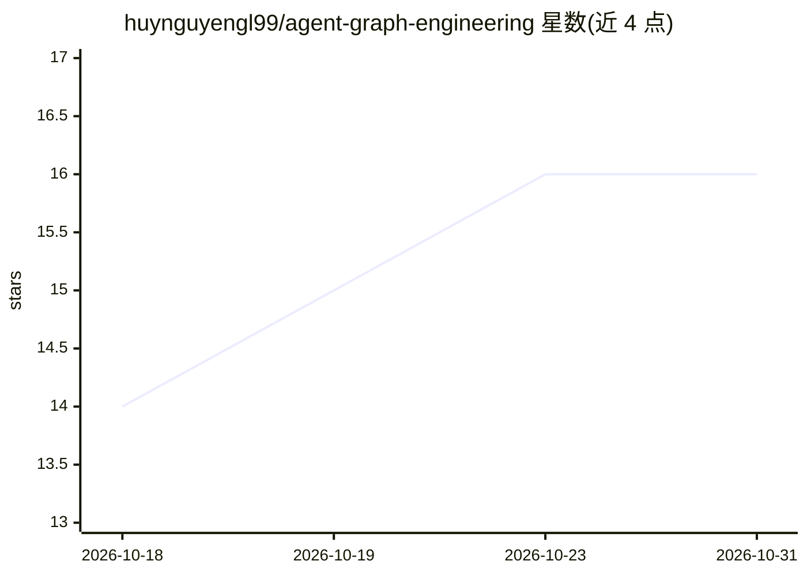

# huynguyengl99/agent-graph-engineering

⭐ 16 · Python · MIT · 推送 2026-10-30 · [GitHub](https://github.com/huynguyengl99/agent-graph-engineering) · [官网](https://huynguyengl99.github.io/series/agent-graph-engineering/) · 个人维护

**面向开发者的 LLM 客服 agent 生产级参考实现**

以客服工单场景演示 AI agent 生产化架构的单仓库参考实现：Django 承载业务记录、FastAPI 承载 agent、React 提供双前端。Agent 流程用 LangGraph 声明为图（可绘制、可暂停、可恢复），Pydantic AI 提供类型化工具与输出，服务边界通过生成的 OpenAPI/AsyncAPI 契约约束。不可逆操作（如退款）需人工审批并可在不同 socket 恢复；自带基于 OpenTelemetry span 的追踪与按次运行成本统计。无 API key 时可用内置脚本模型驱动全流程，just setup / just up 一键运行。README 明确列出上线前需补齐的配置、TLS、限流重试等事项。

## 筛选速览

| 维度 | 判定 | 备注 |
|---|---|---|
| AI 角色 | `ai-ecosystem` | LLM/agent 周边工具 |
| 许可风险 | `permissive` | MIT |
| 部署形态 | `None` |  |
| 模型依赖 | — | README 未给出锁定关系 |
| 硬件要求 | — | 无带数字的原话,不猜 |
| 安装摩擦 | `low` | 无编译、无系统依赖或容器化 |
| 成熟度 | — | 结构信号不足 |

## 能力要点

- LangGraph 声明式流程图：可暂停等待人工审批并在不同连接上恢复
- OpenAPI/AsyncAPI 生成契约与 TypeScript/Python 客户端，边界类型安全
- 每图节点一个 span、模型调用嵌套其中，含按次运行成本，可直接转发到 OTLP collector
- 无 API key 时内置脚本模型驱动全部流程，端到端演示不需要账号

## 适用场景

- 学习 LLM agent 系统的生产化架构（流程图、人审、契约生成、追踪）
- 以此为模板搭建带人工审批的客服或工单自动化系统
- 了解 agent 运行如何在工作线程中持久化并在部署后存活

## 场景标签

`Agent 框架` · 领域:Agent 开发

## 证据(README 行号)

> L3: **A support desk where an AI agent works the tickets, built as a reference for how to put one in production.**
> L61: |`agent/`|FastAPI, LangGraph, Pydantic AI, chanx|8001|

## 星数曲线

2026-10-18 14 → 2026-10-31 16（+2）

---
*卡片 v1 · prompt 1.4 · 生成 2026-10-30 · 置信度 high · 依据 README sha `02f3b79f2ac8` · [字段定义](../../DATASET.md)*
