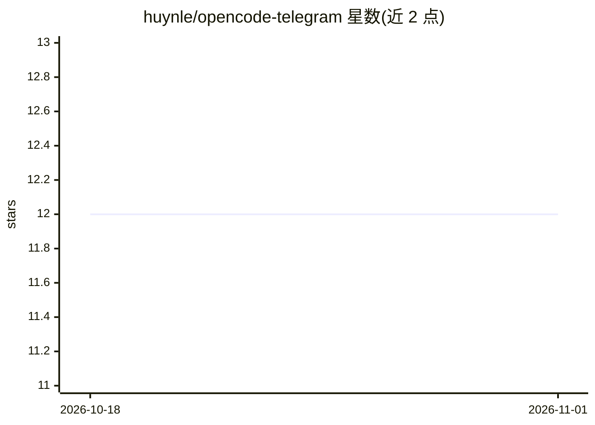

# huynle/opencode-telegram

⭐ 12 · TypeScript · MIT · 推送 2026-01-04 · [GitHub](https://github.com/huynle/opencode-telegram) · 个人维护

**通过 Telegram 论坛话题编排多个 OpenCode 实例的机器人**

基于 Bun + TypeScript + grammY 的 Telegram 机器人：在超群的每个论坛话题中绑定一个独立的 OpenCode 实例，实现多用户/多项目的 AI 编程辅助。功能含实例生命周期管理（自动启动、健康检查、崩溃恢复、空闲超时）、SSE 流式输出转 Telegram 可编辑消息、通过 ps/lsof 发现主机上已运行的 OpenCode 会话、SQLite 持久化状态、危险操作审批按钮及 4200 端口外部实例注册 API。Docker 下进程发现受限，README 推荐原生 Bun 运行。

## 筛选速览

| 维度 | 判定 | 备注 |
|---|---|---|
| AI 角色 | `ai-ecosystem` | LLM/agent 周边工具 |
| 许可风险 | `permissive` | MIT |
| 部署形态 | `self-host` | docker 或自建部署 |
| 模型依赖 | — | README 未给出锁定关系 |
| 硬件要求 | — | 无带数字的原话,不猜 |
| 安装摩擦 | `low` | 无编译、无系统依赖或容器化 |
| 成熟度 | — | 结构信号不足 |

## 能力要点

- 每个论坛话题绑定独立 OpenCode 实例
- 实例生命周期管理：自动启动、健康检查、崩溃恢复、空闲超时
- SSE 事件流式转发为 Telegram 可编辑消息
- 外部实例注册 API（端口 4200）与 SQLite 持久化状态

## 适用场景

- 在 Telegram 群里为多个项目并行使用 AI 编程助手
- 把主机上已运行的 OpenCode 会话接入 Telegram 话题
- 通过内联按钮审批 AI 的危险操作

## 场景标签

`编码 Agent` · 领域:编码与开发

## 证据(README 行号)

> L8: A Telegram bot that orchestrates multiple OpenCode instances through forum topics. Each forum topic in a Telegram su
> L14: - **Session Discovery**: Connect to any running OpenCode instance on your machine

## 星数曲线

2026-10-18 12 → 2026-11-01 12（+0）

---
*卡片 v1 · prompt 1.4 · 生成 2026-11-01 · 置信度 high · 依据 README sha `f5818fc9cec5` · [字段定义](../../DATASET.md)*
