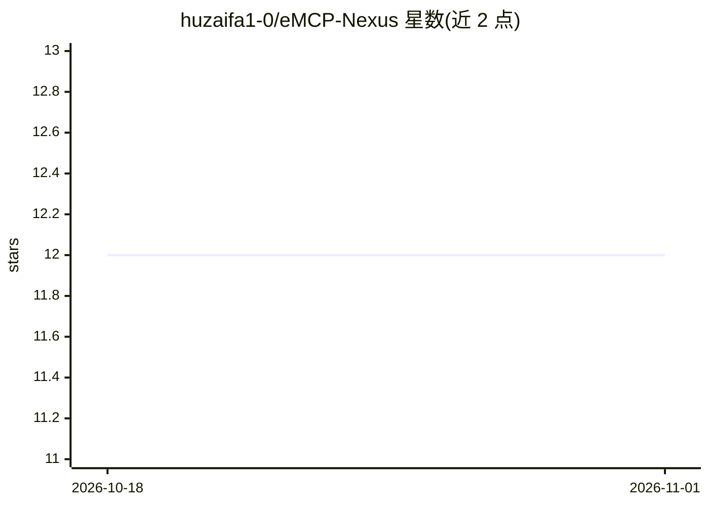

# huzaifa1-0/eMCP-Nexus

⭐ 12 · Python · MIT · 推送 2026-08-10 · [GitHub](https://github.com/huzaifa1-0/eMCP-Nexus) · [官网](https://e-mcp-nexus.vercel.app) · 个人维护

**MCP 工具的 AI 驱动市场：按任务付费部署与变现工具**

面向 AI 工程师与工具使用者的 MCP 工具交易平台：工程师连接 GitHub 仓库即可部署 MCP 工具、自行定价按任务执行收费（支持 Stripe 与加密货币支付），用户通过自然语言语义搜索（FAISS 向量检索）、推荐系统和 RAG 客服机器人发现并按次付费调用工具。含创作者分析面板、用户门户与基于评分和执行成功率的信誉系统。本地开发需 Python 3.9+、可选 Docker 与 Node.js，用 uvicorn 启动 FastAPI 后端并访问 Swagger 文档。

## 筛选速览

| 维度 | 判定 | 备注 |
|---|---|---|
| AI 角色 | `ai-ecosystem` | LLM/agent 周边工具 |
| 许可风险 | `permissive` | MIT |
| 部署形态 | `self-host` | docker 或自建部署 |
| 模型依赖 | — | README 未给出锁定关系 |
| 硬件要求 | — | 无带数字的原话,不猜 |
| 安装摩擦 | `low` | 无编译、无系统依赖或容器化 |
| 成熟度 | — | 结构信号不足 |

## 能力要点

- GitHub 仓库连接式 MCP 工具一键部署与按任务计费（Stripe/加密货币）
- FAISS 向量语义搜索支持自然语言查找工具
- 基于使用模式与工具质量的推荐系统
- RAG 客服机器人提供工具选型与排障问答

## 适用场景

- AI 工程师将 MCP 工具上架并按任务执行获得收入
- 用自然语言描述需求查找并按次付费调用 MCP 工具
- 通过对话式 AI 助手获取工具选型与集成支持

## 场景标签

`聊天机器人` `RAG` `语义搜索` `推荐系统` · 领域:对话与助手

## 证据(README 行号)

> L4: eMCP Nexus is an AI-powered marketplace that connects AI engineers with users through a revolutionary **pay-per-task
> L117: - **Pay-Per-Task Billing:** Flexible micro-payment system supporting crypto and traditional payments.
> L119: - **User Portal:** Discover, test, and integrate MCP tools with simple API calls.

## 星数曲线

2026-10-18 12 → 2026-11-01 12（+0）

---
*卡片 v1 · prompt 1.4 · 生成 2026-11-01 · 置信度 mid · 依据 README sha `1019ee6e89c1` · [字段定义](../../DATASET.md)*
