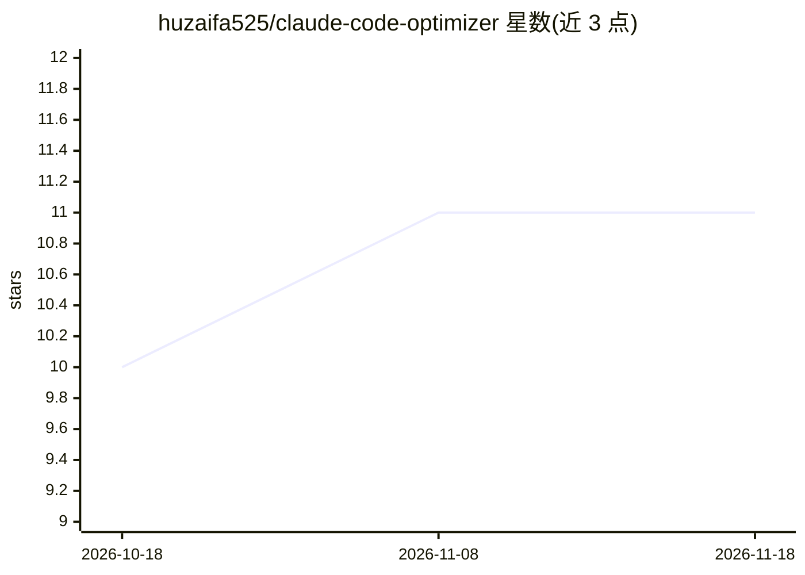

# huzaifa525/claude-code-optimizer

⭐ 11 · Shell · MIT · 推送 2026-03-30 · [GitHub](https://github.com/huzaifa525/claude-code-optimizer) · [官网](https://www.npmjs.com/package/claude-code-optimizer) · 个人维护

**为 Claude Code 用户提供技能/钩子/规则包以降低 token 消耗**

通过 npm 全局安装的 Claude Code 扩展工具包，向 ~/.claude/ 写入 25 个 slash 命令技能、6 条路径级规则、13 个自动触发的 hooks 和 2 个模板（CLAUDE.md/.claudeignore）。核心机制为分层渐进式上下文加载（文件索引→入口→深读）、会话记忆持久化到 ~/.claude/sessions/、fork 子代理隔离探索上下文，以及三档优化模式（aggressive/balanced/thorough）控制思考预算。另提供 curl 与 PowerShell 安装脚本及卸载命令。

## 筛选速览

| 维度 | 判定 | 备注 |
|---|---|---|
| AI 角色 | `ai-ecosystem` | LLM/agent 周边工具 |
| 许可风险 | `permissive` | MIT |
| 部署形态 | `library` | 以包/库形式分发 |
| 模型依赖 | — | README 未给出锁定关系 |
| 硬件要求 | — | 无带数字的原话,不猜 |
| 安装摩擦 | `low` | 无编译、无系统依赖或容器化 |
| 成熟度 | — | 结构信号不足 |

## 能力要点

- 25 个 slash 命令覆盖探索、开发、Git、安全扫描等流程
- 渐进式三层探索（/explore-area）在子代理中运行以隔离 token 开销
- 会话摘要持久化并在下次启动注入
- 13 个 hooks 与路径级规则自动加载

## 适用场景

- 为使用 Claude Code 的项目生成 CLAUDE.md 与 .claudeignore
- 通过 /tdd、/review 等命令规范开发与审查流程
- 用 /security-scan 扫描 OWASP 类漏洞
- 用 /token-check 分析会话 token 使用情况

## 场景标签

`编码 Agent` · 领域:编码与开发

## 证据(README 行号)

> L11: **The #1 toolkit to make Claude Code faster, cheaper, and smarter.**
> L70: That's it. Skills, rules, hooks, and templates are installed to `~/.claude/` automatically.
> L121: |Skills|25|`~/.claude/skills/`|Slash commands for every workflow|

## 星数曲线

2026-10-18 10 → 2026-11-18 11（+1）

---
*卡片 v1 · prompt 1.4 · 生成 2026-11-18 · 置信度 high · 依据 README sha `3985e9eaf6ee` · [字段定义](../../DATASET.md)*
