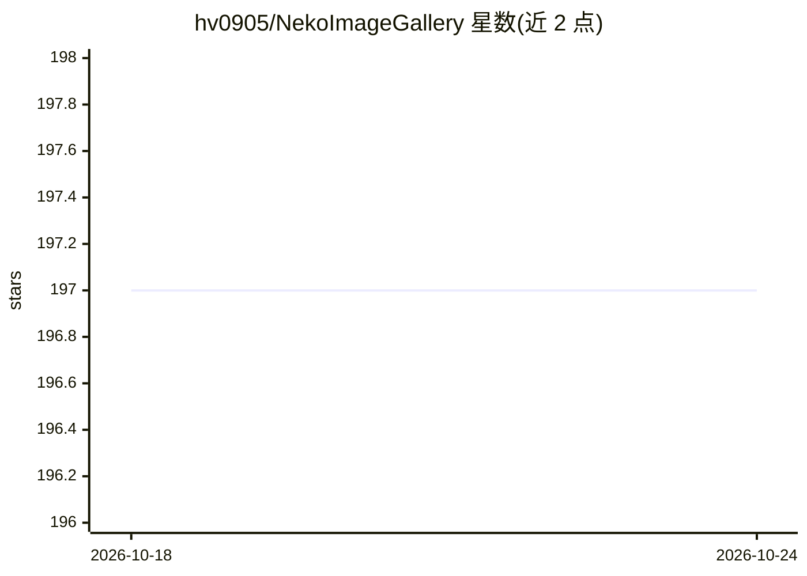

# hv0905/NekoImageGallery

⭐ 197 · Python · AGPL-3.0 · 推送 2026-04-13 · [GitHub](https://github.com/hv0905/NekoImageGallery) · [官网](https://image-insights.edgeneko.com/) · 个人维护 · 中文 README

**基于 CLIP 的 AI 图片搜索引擎：自然语言与以图搜图**

自部署的在线图片搜索引擎：用 CLIP 为每张图片生成 768 维向量，支持关键词搜索与相似图片搜索，无需人工标注；OCR 路径用 PaddleOCR 提取图内文字并以 BERT 生成文本向量实现文字搜索。向量检索依赖 Qdrant 数据库（也可用本地 SQLite 文件存储，搜索复杂度 O(n)）。提供本地 uv 部署与 Docker 多变体镜像（CPU/CUDA/ARM），镜像内捆绑 CLIP、bert-base-chinese 与 OCR 模型权重，支持内置 Web 前端与 FastAPI Swagger 文档。

## 筛选速览

| 维度 | 判定 | 备注 |
|---|---|---|
| AI 角色 | `ai-native` | 本体是模型或模型工具 |
| 许可风险 | `viral` | AGPL-3.0 |
| 部署形态 | `self-host` | docker 或自建部署 |
| 模型依赖 | — | README 未给出锁定关系 |
| 硬件要求 | `cpu-ok` | |
| 安装摩擦 | `low` | 无编译、无系统依赖或容器化 |
| 成熟度 | — | 结构信号不足 |

## 能力要点

- CLIP 生成 768 维向量，支持关键词与以图搜图，无需人工标注
- PaddleOCR + BERT 的图内文字（OCR）搜索
- Docker 多变体镜像（CUDA12.4/CUDA11.8/CPU/ARM）预捆绑全部模型权重
- v1.5.0+ 内置前端与本地目录批量索引（local-index）

## 适用场景

- 为个人或团队图片库搭建自然语言搜索服务
- 用一张图片查找相似图片
- 按图片内出现的文字内容检索图片

## 场景标签

`语义搜索` · 领域:知识与检索

## 证据(README 行号)

> L9: An online AI image search engine based on the Clip model and Qdrant vector database. Supports keyword search and sim
> L16: - Use the Clip model to generate 768-dimensional vectors for each image as the basis for search. No need for manual
> L18: - OCR Text search is supported, use PaddleOCR to extract text from images and use BERT to generate text vectors for

## 星数曲线

2026-10-18 197 → 2026-10-24 197（+0）

---
*卡片 v1 · prompt 1.4 · 生成 2026-10-22 · 置信度 high · 依据 README sha `0166a75b5459` · [字段定义](../../DATASET.md)*
