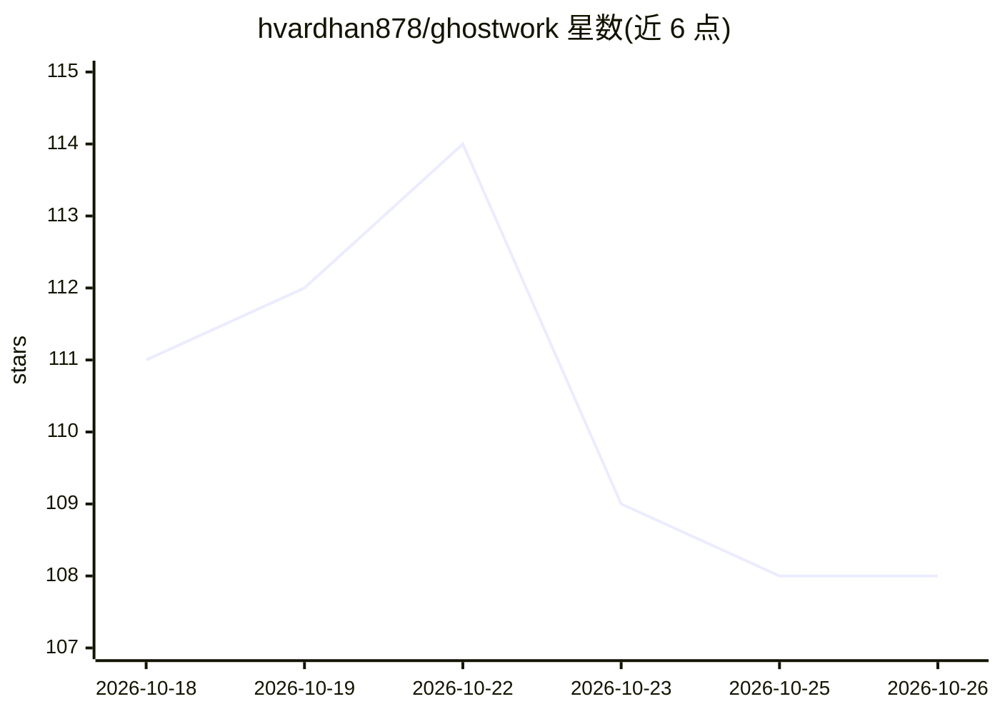

# hvardhan878/ghostwork

⭐ 108 · TypeScript · NOASSERTION · 推送 2026-07-02 · [GitHub](https://github.com/hvardhan878/ghostwork) · 个人维护

**macOS 本地屏幕记录与自动化代理：从观察中学习并代执行重复任务**

基于 Electron 的开源 Screenpipe GUI 与 macOS 自动化代理：通过免费的 Screenpipe CLI 记录屏幕与交互，构建 L1-L4 四层记忆（工作记忆、情景、语义规则、可执行技能），夜间运行三阶段整理（NREM/REM/GC）将观察提升为规则与技能。执行栈为技能零 token 重放、macOS 辅助功能 API 原生控制、Claude 视觉回退。分 Supervised/Autonomous 两级自治，外显动作需一次确认。需 macOS 12+、Screenpipe、Node.js 20+ 及 OpenRouter（或 Anthropic）API key，从源码构建运行。

## 筛选速览

| 维度 | 判定 | 备注 |
|---|---|---|
| AI 角色 | `ai-native` | 本体是模型或模型工具 |
| 许可风险 | `none` | NOASSERTION |
| 部署形态 | `desktop` | 安装包/桌面程序 |
| 模型依赖 | locked-api |  |
| 硬件要求 | — | 无带数字的原话,不猜 |
| 安装摩擦 | `low` | 无编译、无系统依赖或容器化 |
| 成熟度 | — | 结构信号不足 |

## 能力要点

- 四层记忆架构与夜间 NREM/REM/GC 整理循环
- 执行栈：技能重放 + macOS AX 原生控制 + Claude 视觉回退
- 分级自治：外显动作（发邮件/提交表单）始终需一次确认
- 数据全部本地留存，LLM 调用前剥离 PII

## 适用场景

- 免费替代付费 Screenpipe 桌面端，查看屏幕历史时间线与自然语言搜索
- 让代理从日常工作观察中学到规则并自动执行重复流程
- 分析各应用使用情况并获得本地化工作流自动化

## 场景标签

`工作流自动化` `GUI 自动化` · 领域:效率与自动化

## 证据(README 行号)

> L8: Ghostwork runs silently in the background, learns how you work from observation alone, and gradually takes repetitiv
> L29: Ghostwork watches every interaction across every app on your Mac (via Screenpipe), builds a rich memory of your wor
> L133: |`computerUse.ts`|AX-first executor + Claude vision fallback|

## 星数曲线

2026-10-18 111 → 2026-10-26 108（-3）

---
*卡片 v1 · prompt 1.4 · 生成 2026-10-23 · 置信度 high · 依据 README sha `aebd7995b461` · [字段定义](../../DATASET.md)*
