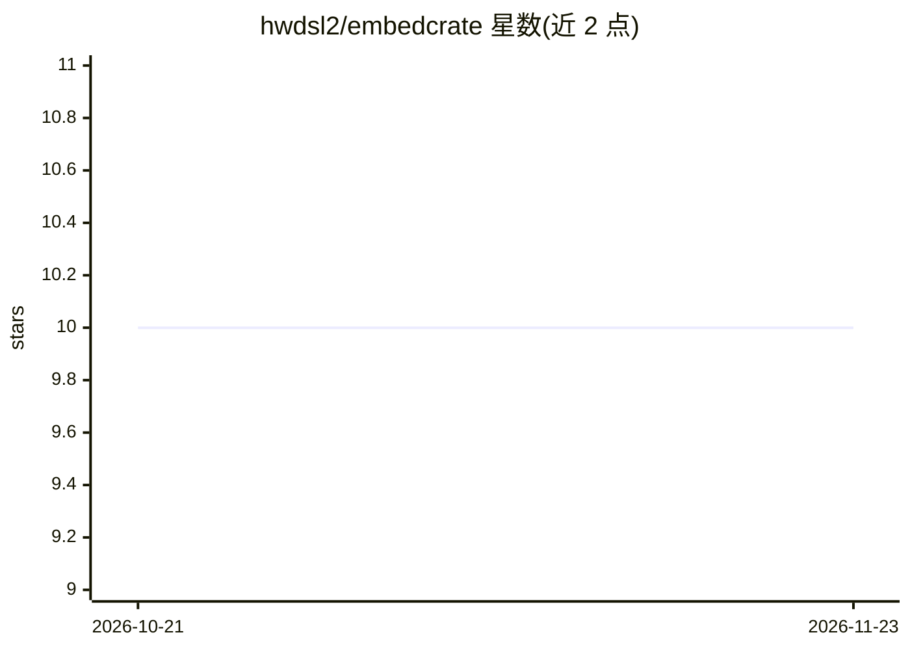

# hwdsl2/embedcrate

⭐ 10 · Shell · NOASSERTION · 推送 2026-11-18 · [GitHub](https://github.com/hwdsl2/embedcrate) · [官网](https://embedcrate.com) · 组织维护

**自托管文本嵌入与重排 API 服务器，供开发者本地运行**

基于 Hugging Face TEI 后端的 Docker 化嵌入/重排服务器：提供 OpenAI 兼容的 /v1/embeddings 端点与可选 /rerank 端点（cross-encoder 模型），支持 BGE、Nomic 等嵌入模型选择、API key 认证（支持从文件加载密钥）、通过环境变量配置模型与端口、EMBED_LOCAL_ONLY 离线/气隙运行与模型持久缓存。要求带 Docker 的 Linux 服务器，默认模型约需 250 MB 空闲内存，支持 amd64/arm64 架构，提供 docker run 与 docker-compose 两种部署方式。

## 筛选速览

| 维度 | 判定 | 备注 |
|---|---|---|
| AI 角色 | `ai-ecosystem` | LLM/agent 周边工具 |
| 许可风险 | `permissive` | NOASSERTION |
| 部署形态 | `self-host` | docker 或自建部署 |
| 模型依赖 | — | README 未给出锁定关系 |
| 硬件要求 | — | 无带数字的原话,不猜 |
| 安装摩擦 | `low` | 无编译、无系统依赖或容器化 |
| 成熟度 | — | 结构信号不足 |

## 能力要点

- OpenAI 兼容 /v1/embeddings API，可对接 OpenAI SDK
- 可选 /rerank 端点，使用 cross-encoder 模型对检索文档重打分
- API key 认证，支持环境变量与密钥文件两种来源，密钥轮换基于容器重启
- EMBED_LOCAL_ONLY 离线/气隙运行，模型持久缓存

## 适用场景

- 在自己的服务器上为应用提供私有文本嵌入服务
- 为 RAG 流程对检索文档做 cross-encoder 重排
- 在无外网的气隙环境中用预缓存模型运行嵌入服务

## 场景标签

`语义搜索` · 领域:知识与检索

## 证据(README 行号)

> L9: Run text embeddings and reranking on your own server with EmbedCrate. Powered by Hugging Face Text Embeddings Infere
> L15: - **OpenAI-compatible API:** `POST /v1/embeddings` for embedding requests from compatible OpenAI SDKs and apps.
> L19: - **High-performance backend:** powered by Hugging Face TEI, a high-performance embeddings server written in Rust.

## 星数曲线

2026-10-21 10 → 2026-11-23 10（+0）

---
*卡片 v1 · prompt 1.4 · 生成 2026-11-19 · 置信度 high · 依据 README sha `e6a0fcfae6eb` · [字段定义](../../DATASET.md)*
