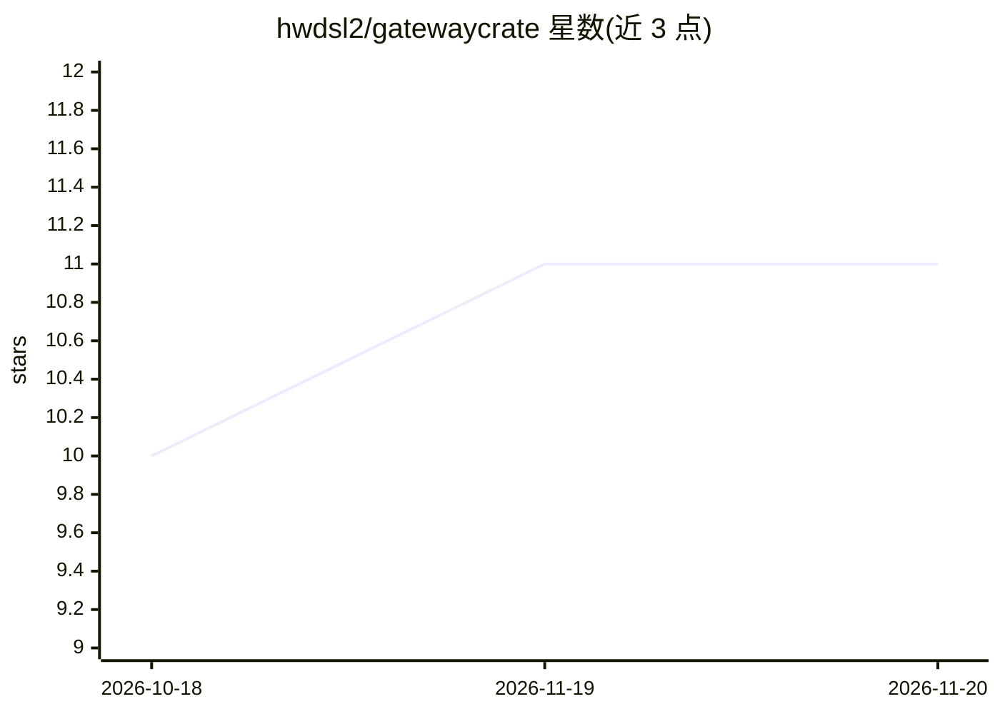

# hwdsl2/gatewaycrate

⭐ 11 · Shell · NOASSERTION · 推送 2026-11-18 · [GitHub](https://github.com/hwdsl2/gatewaycrate) · [官网](https://gatewaycrate.com) · 个人维护

**自托管 AI 网关：统一 OpenAI 兼容 API 接入 100+ 模型提供商**

基于 LiteLLM 的 Docker 化 AI 网关（前名 docker-litellm），为应用提供统一的 OpenAI 兼容 API，屏蔽各云/本地模型提供商差异。首次启动自动生成 master API key 并完成配置，提供 litellm_manage 脚本增删模型；docker-compose 内含 PostgreSQL，启用 Admin UI、虚拟密钥管理与花费追踪。要求 Linux 服务器安装 Docker、开放 4000 端口，至少一个提供商 API key 或本地 Ollama；未测试 Podman、Kubernetes 与 GPU 加速。

## 筛选速览

| 维度 | 判定 | 备注 |
|---|---|---|
| AI 角色 | `ai-ecosystem` | LLM/agent 周边工具 |
| 许可风险 | `permissive` | NOASSERTION |
| 部署形态 | `self-host` | docker 或自建部署 |
| 模型依赖 | local-ok | 支持本地模型 |
| 硬件要求 | — | 无带数字的原话,不猜 |
| 安装摩擦 | `low` | 无编译、无系统依赖或容器化 |
| 成熟度 | — | 结构信号不足 |

## 能力要点

- 首次启动自动生成 master key 并打印到容器日志
- 设置提供商 API key 环境变量即自动添加对应模型
- PostgreSQL 支持 Admin UI、虚拟密钥与花费追踪
- 支持从挂载文件加载密钥及启动式轮换

## 适用场景

- 为多个应用提供统一的 LLM 接入网关并统一计费追踪
- 用虚拟密钥管理团队成员或应用的模型调用额度
- 通过 Ollama base URL 接入本地模型

## 场景标签

`模型网关` · 领域:Agent 开发

## 证据(README 行号)

> L9: Connect applications to configured cloud and local model providers through GatewayCrate. Powered by LiteLLM, it prov
> L17: - **Provider choice:** supports OpenAI, Anthropic, Groq, Gemini, Ollama, and 100+ other providers.

## 星数曲线

2026-10-18 10 → 2026-11-20 11（+1）

---
*卡片 v1 · prompt 1.4 · 生成 2026-11-19 · 置信度 mid · 依据 README sha `54cf4b2efdca` · [字段定义](../../DATASET.md)*
