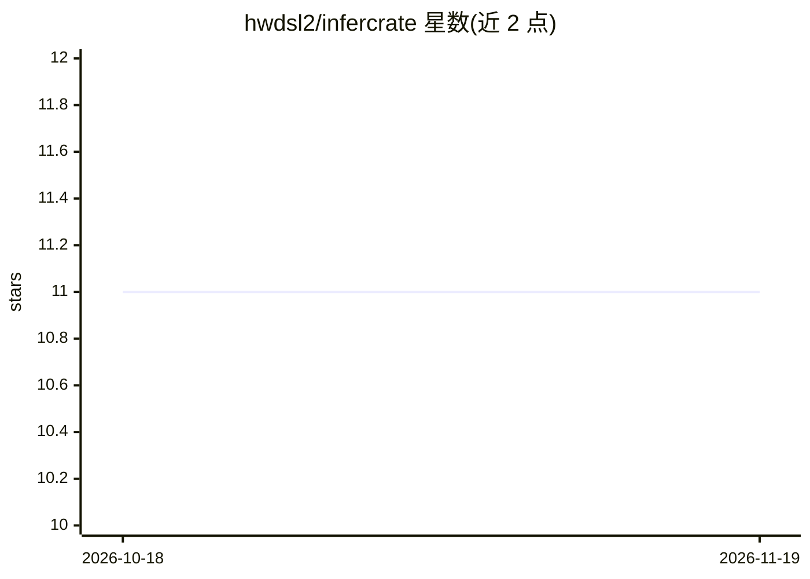

# hwdsl2/infercrate

⭐ 11 · Shell · NOASSERTION · 推送 2026-11-18 · [GitHub](https://github.com/hwdsl2/infercrate) · [官网](https://infercrate.com) · 组织维护 · 中文 README

**基于 Ollama 的自托管本地 LLM 服务器 Docker 镜像**

在自有硬件上运行本地语言模型的 Docker 化服务器，底层由 Ollama 驱动，提供原生 Ollama API 与 OpenAI 兼容的 /v1 API 子集。首次启动自动生成 Bearer token API 密钥，通过 Caddy 强制认证；支持首启预拉取模型（OLLAMA_MODELS 环境变量）、ollama_manage 辅助脚本管理模型、数据持久化到 Docker 卷。CPU 镜像约 80 MB（Debian slim），另有 :cuda 镜像支持 NVIDIA GPU 加速（仅 linux/amd64）。需 Linux 服务器与 Docker，Podman/Kubernetes 等未测试。

## 筛选速览

| 维度 | 判定 | 备注 |
|---|---|---|
| AI 角色 | `ai-ecosystem` | LLM/agent 周边工具 |
| 许可风险 | `permissive` | NOASSERTION |
| 部署形态 | `self-host` | docker 或自建部署 |
| 模型依赖 | local-ok | 支持本地模型 |
| 硬件要求 | — | 无带数字的原话,不猜 |
| 安装摩擦 | `low` | 无编译、无系统依赖或容器化 |
| 成熟度 | — | 结构信号不足 |

## 能力要点

- 自动生成 API 密钥，Caddy 强制 Bearer token 认证
- 原生 Ollama API + OpenAI 兼容 /v1 API 子集
- 首启预拉取模型与 ollama_manage 模型管理脚本
- :cuda 镜像支持 NVIDIA GPU 加速

## 适用场景

- 在私有服务器上自托管本地 LLM 推理服务
- 为 LangChain 等应用提供带认证的 OpenAI 兼容 API 端点
- 在 Docker 卷中持久化管理已下载的模型

## 场景标签

`推理引擎` · 领域:训练与推理

## 证据(README 行号)

> L9: Run local language models on your own hardware with InferCrate. Powered by Ollama, it provides the native Ollama API
> L15: - **OpenAI-compatible API:** a `/v1` API subset for compatible OpenAI SDKs and apps, alongside the native Ollama AP
> L19: - **CPU and GPU support:** run on CPU or use the `:cuda` image for NVIDIA GPU acceleration.

## 星数曲线

2026-10-18 11 → 2026-11-19 11（+0）

---
*卡片 v1 · prompt 1.4 · 生成 2026-11-18 · 置信度 high · 依据 README sha `c5a234a15543` · [字段定义](../../DATASET.md)*
