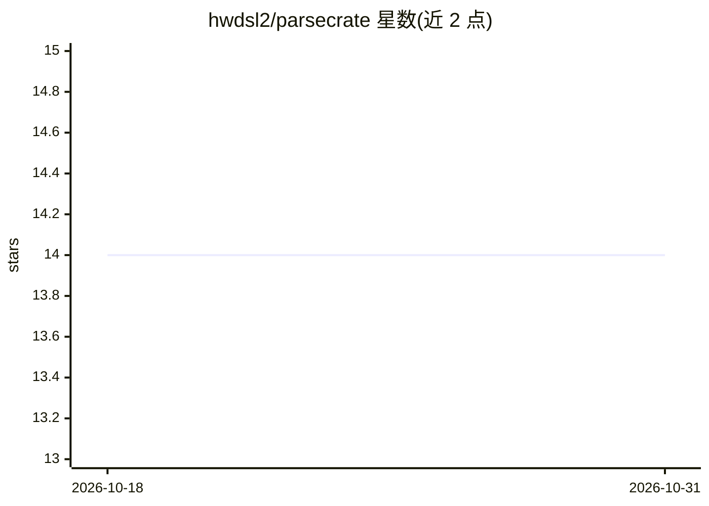

# hwdsl2/parsecrate

⭐ 14 · Jupyter Notebook · NOASSERTION · 推送 2026-10-29 · [GitHub](https://github.com/hwdsl2/parsecrate) · [官网](https://parsecrate.com) · 个人维护 · 中文 README

**自托管文档处理 API：将 PDF/Office/HTML 等转为 Markdown/JSON**

基于 IBM Docling 与 docling-serve 的自托管文档转换 API 服务，以 Docker 镜像部署在 Linux amd64/arm64（GPU 加速镜像仅限 linux/amd64）。支持 PDF、DOCX、PPTX、XLSX、HTML、Markdown、LaTeX、图片等输入，输出 Markdown/JSON/HTML/Text/DocTags；提供同步/异步转换端点、文件上传或 URL 输入、面向 RAG 的分层/混合分块端点，以及可选 Web UI。模型预置在镜像内，可离线运行；支持 API key 认证与 CPU/NVIDIA GPU 两种计算设备。

## 筛选速览

| 维度 | 判定 | 备注 |
|---|---|---|
| AI 角色 | `ai-native` | 本体是模型或模型工具 |
| 许可风险 | `permissive` | NOASSERTION |
| 部署形态 | `self-host` | docker 或自建部署 |
| 模型依赖 | — | README 未给出锁定关系 |
| 硬件要求 | — | 无带数字的原话,不猜 |
| 安装摩擦 | `low` | 无编译、无系统依赖或容器化 |
| 成熟度 | — | 结构信号不足 |

## 能力要点

- PDF/DOCX/PPTX/XLSX/HTML/LaTeX/图片等 10 类输入，5 种输出格式
- 布局分析、OCR 与表格结构识别由 Docling 提供，模型预置在镜像内可离线运行
- 同步/异步转换 API 与 RAG 分层/混合分块端点
- CPU 与 NVIDIA GPU（:cuda 镜像）两种部署方式

## 适用场景

- 在私有服务器上把 PDF/Office 文档转为 Markdown 供 RAG 管线使用
- 通过异步 API 批量处理大文档并轮询取回结果
- 在离线/隔离环境中运行文档解析服务

## 场景标签

`文档解析` · 领域:知识与检索

## 证据(README 行号)

> L9: ParseCrate is a self-hosted document processing API powered by Docling and docling-serve. Convert PDF, DOCX, PPTX, X
> L17: - **Layout, OCR, and tables:** powered by IBM Docling for high-accuracy layout analysis, OCR, and table structure r

## 星数曲线

2026-10-18 14 → 2026-10-31 14（+0）

---
*卡片 v1 · prompt 1.4 · 生成 2026-10-31 · 置信度 high · 依据 README sha `d9f5cac8f445` · [字段定义](../../DATASET.md)*
