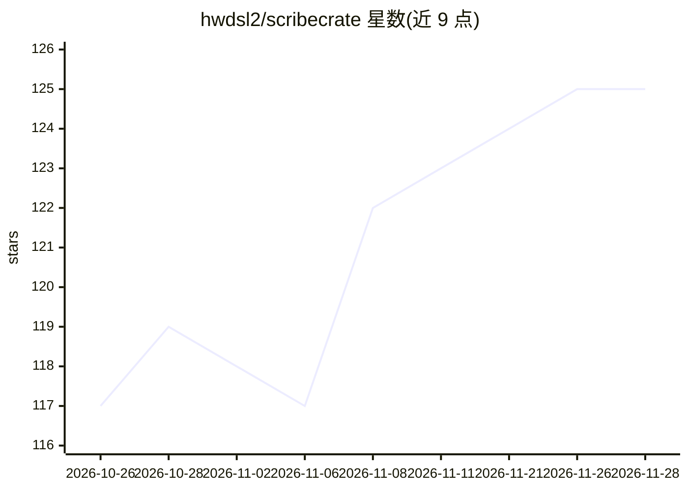

# hwdsl2/scribecrate

⭐ 125 · Python · NOASSERTION · 推送 2026-11-27 · [GitHub](https://github.com/hwdsl2/scribecrate) · [官网](https://scribecrate.com) · 组织维护 · 中文 README

**自托管 Whisper 语音转文字 API 服务器：Docker 一键部署转录与翻译**

基于 faster-whisper 的自托管语音转文字服务，提供 OpenAI 兼容的转录与英译端点，兼容支持 OpenAI Whisper API 的客户端。输出 JSON/纯文本/SRT/VTT，支持 SSE 流式返回解码片段、可选的说话人分离（sherpa-onnx 扩展）、多种 Whisper 模型与 int8/float16 量化。模型可预缓存后离线运行，API key 自动生成。CPU 镜像支持 amd64/arm64，GPU 镜像仅 amd64；另提供实时流式的 ScribeCrate Live 变体。

## 筛选速览

| 维度 | 判定 | 备注 |
|---|---|---|
| AI 角色 | `ai-native` | 本体是模型或模型工具 |
| 许可风险 | `permissive` | NOASSERTION |
| 部署形态 | `self-host` | docker 或自建部署 |
| 模型依赖 | — | README 未给出锁定关系 |
| 硬件要求 | — | 无带数字的原话,不猜 |
| 安装摩擦 | `low` | 无编译、无系统依赖或容器化 |
| 成熟度 | — | 结构信号不足 |

## 能力要点

- OpenAI 兼容的 /v1/audio/transcriptions 与 /v1/audio/translations 端点
- SSE 流式返回转录片段；支持说话人分离（sherpa-onnx + pyannote ONNX）
- WHISPER_LOCAL_ONLY 离线/气隙部署，模型预缓存
- 输出 JSON/SRT/VTT 等格式，支持词级时间戳与重复 n-gram 控制

## 适用场景

- 自托管替代方案处理会议录音并生成字幕
- 对接兼容 OpenAI Whisper API 的现有客户端做本地转录
- 气隙环境用预缓存模型离线转写音频

## 场景标签

`语音识别` · 领域:感知与多模态

## 证据(README 行号)

> L9: ScribeCrate is a self-hosted speech-to-text API for transcribing audio, generating subtitles, and translating speech
> L15: - **OpenAI-compatible API:** `POST /v1/audio/transcriptions` and `POST /v1/audio/translations` endpoints for integr

## 星数曲线

2026-10-26 117 → 2026-11-28 125（+8）

---
*卡片 v1 · prompt 1.4 · 生成 2026-11-28 · 置信度 high · 依据 README sha `a730e0ce0f90` · [字段定义](../../DATASET.md)*
