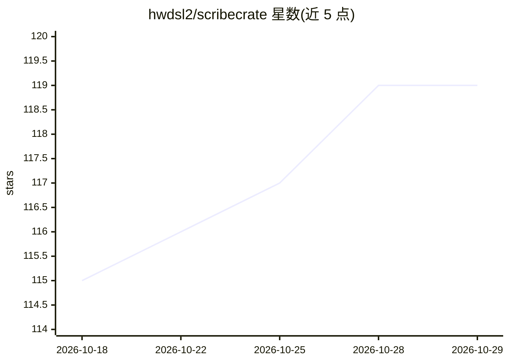

# hwdsl2/scribecrate

⭐ 119 · Python · NOASSERTION · 推送 2026-10-28 · [GitHub](https://github.com/hwdsl2/scribecrate) · [官网](https://scribecrate.com) · 个人维护 · 中文 README

**自托管的 Whisper 语音转文字 API 服务器（OpenAI 兼容）**

基于 faster-whisper 的自托管语音转写 Docker 服务：提供 OpenAI 兼容的 /v1/audio/transcriptions 与 /v1/audio/translations 端点，支持说话人分离（sherpa-onnx 扩展）、SSE 流式分段输出、JSON/SRT/VTT 字幕格式、词级时间戳，以及预缓存模型的离线运行。可在 CPU（amd64/arm64）或 NVIDIA GPU（:cuda 镜像）上部署，通过环境变量配置模型、量化类型与解码参数。给需要私有化、本地处理音频的部署者使用。

## 筛选速览

| 维度 | 判定 | 备注 |
|---|---|---|
| AI 角色 | `ai-ecosystem` | LLM/agent 周边工具 |
| 许可风险 | `permissive` | NOASSERTION |
| 部署形态 | `self-host` | docker 或自建部署 |
| 模型依赖 | — | README 未给出锁定关系 |
| 硬件要求 | — | 无带数字的原话,不猜 |
| 安装摩擦 | `low` | 无编译、无系统依赖或容器化 |
| 成熟度 | — | 结构信号不足 |

## 能力要点

- OpenAI 兼容的转写与英译 API 端点
- 可选说话人分离（sherpa-onnx + pyannote 分割模型）
- SSE 流式分段输出与 JSON/SRT/VTT 字幕格式
- WHISPER_LOCAL_ONLY 支持预缓存模型的离线/气隙部署

## 适用场景

- 自建私有语音转写/字幕生成服务，音频不出本机
- 让支持 OpenAI Whisper API 的客户端直接对接本地服务
- 在 GPU 或树莓派等 arm64 设备上部署转写后端

## 场景标签

`语音识别` · 领域:感知与多模态

## 证据(README 行号)

> L9: ScribeCrate is a self-hosted speech-to-text API for transcribing audio, generating subtitles, and translating speech
> L15: - **OpenAI-compatible API:** `POST /v1/audio/transcriptions` and `POST /v1/audio/translations` endpoints for integr

## 星数曲线

2026-10-18 115 → 2026-10-29 119（+4）

---
*卡片 v1 · prompt 1.4 · 生成 2026-10-23 · 置信度 high · 依据 README sha `770b02bed08f` · [字段定义](../../DATASET.md)*
