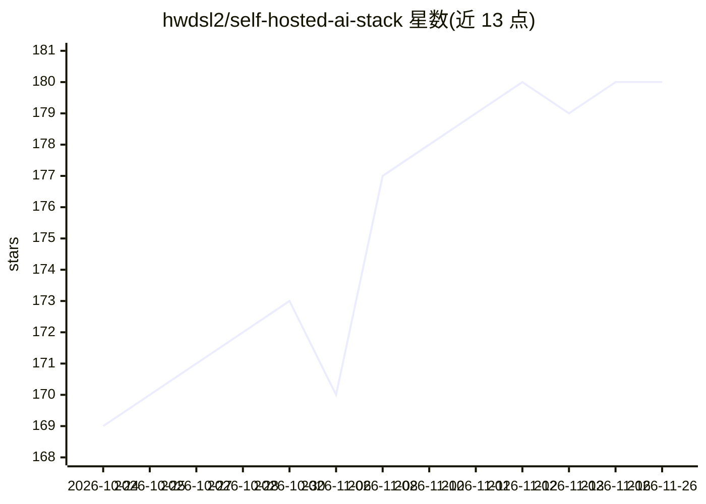

# hwdsl2/self-hosted-ai-stack

⭐ 180 · Shell · MIT · 推送 2026-11-18 · [GitHub](https://github.com/hwdsl2/self-hosted-ai-stack) · [官网](https://selfhostedaistack.com) · 个人维护 · 中文 README

**用 Docker Compose 一键部署自托管本地 AI 服务栈**

以 Docker Compose 编排的开源自托管 AI 套件：通过 Ollama 运行本地 LLM，AnythingLLM 提供密码保护的 Web 聊天界面，LiteLLM 网关路由请求至 100+ 提供商，另含向量嵌入、语音转录（含实时 STT）、TTS、文档解析与 MCP 工具服务。首次启动自动配置，API 密钥自动生成，可选 Caddy HTTPS 覆盖层、NVIDIA CUDA 加速与低内存轻量栈（约 4.5 GB 起），支持 amd64/arm64 与 Podman。面向希望在自有服务器上运行本地 AI 服务栈的用户。

## 筛选速览

| 维度 | 判定 | 备注 |
|---|---|---|
| AI 角色 | `ai-ecosystem` | LLM/agent 周边工具 |
| 许可风险 | `permissive` | MIT |
| 部署形态 | `self-host` | docker 或自建部署 |
| 模型依赖 | local-ok | 支持本地模型 |
| 硬件要求 | — | 无带数字的原话,不猜 |
| 安装摩擦 | `low` | 无编译、无系统依赖或容器化 |
| 成熟度 | — | 结构信号不足 |

## 能力要点

- Docker Compose 一条命令部署完整 AI 栈，服务首次启动自动配置
- 8 个预配置轻量栈变体（chat-ui/voice-pipeline/rag-pipeline 等）按需选用
- NVIDIA CUDA 加速与 HTTPS（Caddy）可选覆盖
- 内置 stack-check.sh 健康检查与自动生成密钥管理

## 适用场景

- 在自己服务器上搭建本地文档问答/RAG 服务
- 搭建语音转文字→LLM→语音合成的语音对话管线
- 为 goose 等 AI agent 提供本地模型网关与 MCP 工具

## 场景标签

`模型网关` `聊天机器人` `RAG` `文档问答` · 领域:Agent 开发

## 证据(README 行号)

> L11: Run local AI models, chat with your documents, transcribe audio, and connect MCP tools with Docker Compose. Optiona
> L33: |**GatewayCrate (LiteLLM)**|AI gateway with Admin UI — routes requests to InferCrate and 100+ providers|`4000`|
> L55: docker compose up -d

## 星数曲线

2026-10-24 169 → 2026-11-26 180（+11）

---
*卡片 v1 · prompt 1.4 · 生成 2026-11-26 · 置信度 high · 依据 README sha `79880b30e624` · [字段定义](../../DATASET.md)*
