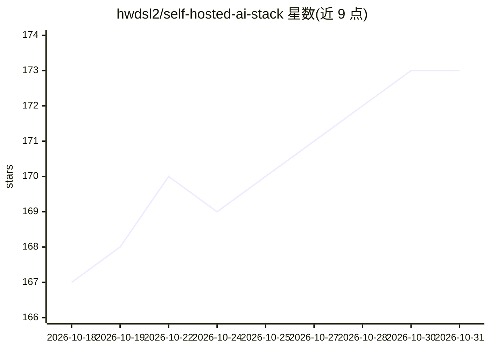

# hwdsl2/self-hosted-ai-stack

⭐ 173 · Shell · MIT · 推送 2026-10-24 · [GitHub](https://github.com/hwdsl2/self-hosted-ai-stack) · [官网](https://selfhostedaistack.com) · 个人维护

**Docker Compose 一键部署的自托管 AI 服务全家桶**

基于 Docker Compose 的自托管 AI 栈编排项目：打包 Ollama 本地 LLM（InferCrate）、LiteLLM 网关（GatewayCrate）、AnythingLLM 聊天界面、Hugging Face TEI 嵌入、Whisper 语音转写、Kokoro TTS、Docling 文档解析与 MCPHub 工具服务，首次启动自动配置与密钥生成。面向有 Linux 服务器的开发者和自托管用户，提供 8 种轻量子栈（最低约 4.5 GB 内存），支持可选 NVIDIA CUDA 加速（CUDA 镜像仅 linux/amd64）、Podman 运行与 Caddy HTTPS 覆盖层。

## 筛选速览

| 维度 | 判定 | 备注 |
|---|---|---|
| AI 角色 | `ai-ecosystem` | LLM/agent 周边工具 |
| 许可风险 | `permissive` | MIT |
| 部署形态 | `self-host` | docker 或自建部署 |
| 模型依赖 | local-ok | 支持本地模型 |
| 硬件要求 | — | 无带数字的原话,不猜 |
| 安装摩擦 | `low` | 无编译、无系统依赖或容器化 |
| 成熟度 | — | 结构信号不足 |

## 能力要点

- 一条 docker compose 命令启动含 LLM/聊天/转写/TTS/MCP 的完整栈
- 8 种轻量子栈按用途组合服务，最低约 4.5 GB 内存
- 默认本地运行，自动生成密钥与 AnythingLLM 管理密码
- 可选 NVIDIA CUDA GPU 加速与 Caddy HTTPS 覆盖层

## 适用场景

- 在自己服务器上搭建本地 LLM 聊天与文档问答
- 组合语音转写→LLM→语音合成的语音流水线
- 通过 LiteLLM 网关统一访问本地模型和外部提供商
- 为 goose 等 AI 客户端提供本地推理与 MCP 工具后端

## 场景标签

`模型网关` `语音合成` `语音识别` `文档解析` · 领域:Agent 开发

## 证据(README 行号)

> L11: Run local AI models, chat with your documents, transcribe audio, and connect MCP tools with Docker Compose. Optiona
> L33: |**GatewayCrate (LiteLLM)**|AI gateway with Admin UI — routes requests to InferCrate and 100+ providers|`4000`|
> L55: docker compose up -d

## 星数曲线

2026-10-18 167 → 2026-10-31 173（+6）

---
*卡片 v1 · prompt 1.4 · 生成 2026-10-22 · 置信度 high · 依据 README sha `e28b75731d69` · [字段定义](../../DATASET.md)*
