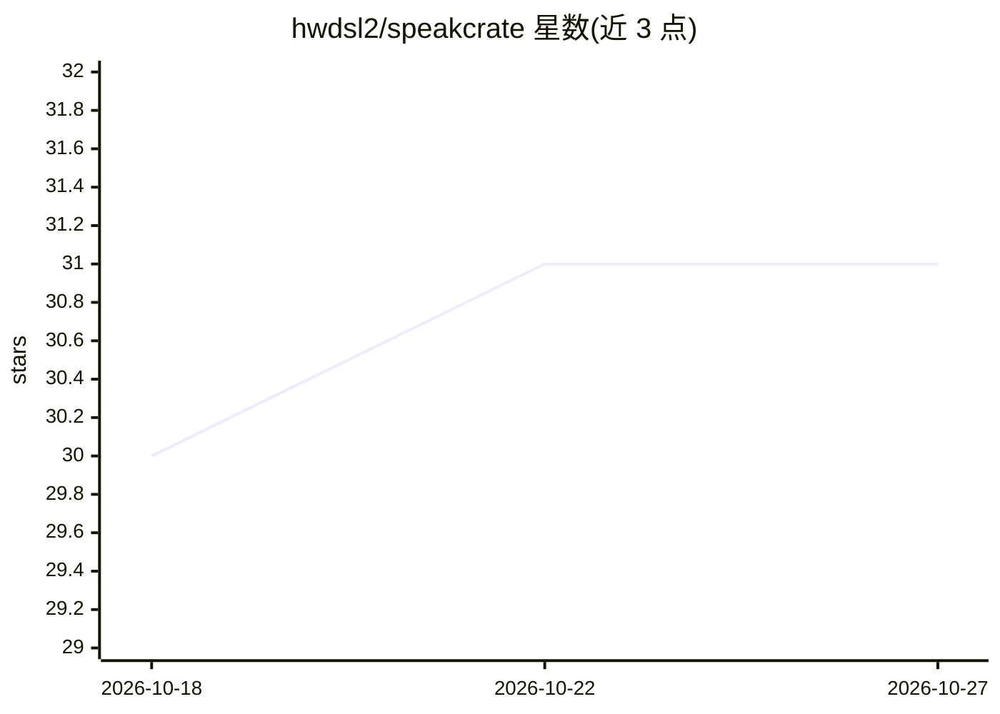

# hwdsl2/speakcrate

⭐ 31 · Python · NOASSERTION · 推送 2026-10-24 · [GitHub](https://github.com/hwdsl2/speakcrate) · [官网](https://speakcrate.com) · 个人维护

**自托管文本转语音 API：基于 Kokoro，兼容 OpenAI 接口**

基于 Kokoro-82M 模型的自托管 TTS 服务，以 Docker 镜像（hwdsl2/kokoro-server）形式部署在 Linux CPU（amd64/arm64）或 NVIDIA GPU（:cuda 镜像，仅 linux/amd64）上。提供 OpenAI 兼容端点 POST /v1/audio/speech，含 54 种声音、9 种语言，支持 mp3/wav/flac/opus/aac/pcm 六种输出格式与 audio/SSE 两种流式返回。支持 Bearer 鉴权、环境变量配置、docker-compose 部署，以及通过 KOKORO_LOCAL_ONLY 离线运行。文本上限 4096 字符；instructions 字段接受但不被引擎支持。

## 筛选速览

| 维度 | 判定 | 备注 |
|---|---|---|
| AI 角色 | `ai-native` | 本体是模型或模型工具 |
| 许可风险 | `permissive` | NOASSERTION |
| 部署形态 | `self-host` | docker 或自建部署 |
| 模型依赖 | — | README 未给出锁定关系 |
| 硬件要求 | — | 无带数字的原话,不猜 |
| 安装摩擦 | `low` | 无编译、无系统依赖或容器化 |
| 成熟度 | — | 结构信号不足 |

## 能力要点

- OpenAI 兼容 /v1/audio/speech 端点，OpenAI SDK 可直连
- 54 种声音、9 种语言，接受 OpenAI 声音别名映射到本地 Kokoro 声音
- audio/SSE 流式返回与六种输出格式
- CPU 与 NVIDIA GPU（CUDA）镜像，支持离线预缓存模型运行

## 适用场景

- 在自有服务器上搭建私有 TTS API，音频不出本地
- 让使用 OpenAI SDK 的应用切换到自托管语音合成后端
- 在无外网的隔离环境（air-gapped）运行 TTS 服务

## 场景标签

`语音合成` · 领域:内容生成

## 证据(README 行号)

> L9: SpeakCrate is a self-hosted text-to-speech API powered by Kokoro. It provides an OpenAI-compatible speech endpoint, 
> L15: - **OpenAI-compatible API:** `POST /v1/audio/speech` for text-to-speech requests from compatible OpenAI SDKs and ap

## 星数曲线

2026-10-18 30 → 2026-10-27 31（+1）

---
*卡片 v1 · prompt 1.4 · 生成 2026-10-26 · 置信度 high · 依据 README sha `0182c4a40a5e` · [字段定义](../../DATASET.md)*
