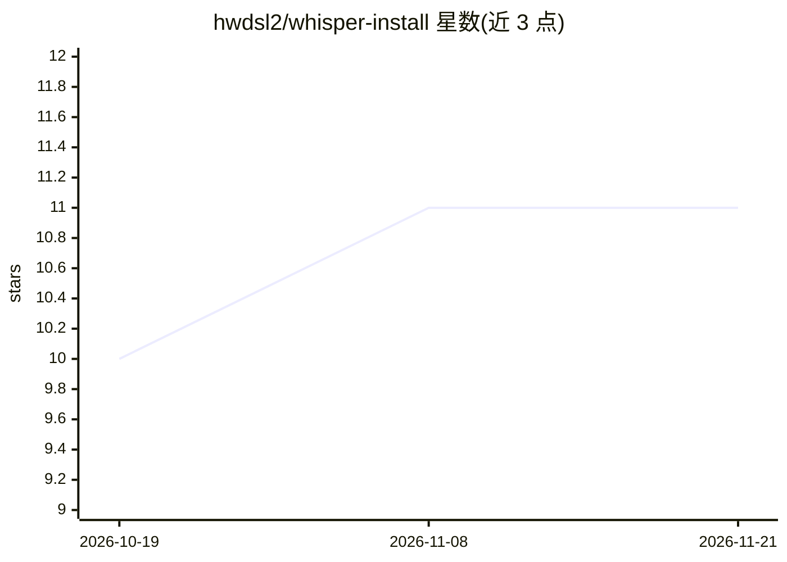

# hwdsl2/whisper-install

⭐ 11 · Python · NOASSERTION · 推送 2026-11-18 · [GitHub](https://github.com/hwdsl2/whisper-install) · 个人维护

**Linux 一键安装 Whisper 语音转写 API 服务器脚本**

Bash 安装脚本，在 Ubuntu/Debian/AlmaLinux/Rocky/CentOS/RHEL/Fedora 上自动部署基于 faster-whisper 的自托管语音转写服务器，提供 OpenAI 兼容的 /v1/audio/transcriptions 与 /v1/audio/translations 端点。脚本自动安装 Python 环境与依赖、创建系统用户、生成 API key 并配置 systemd 服务。支持词级时间戳、JSON/SRT/VTT 输出、SSE 流式返回，可离线运行预缓存模型；OpenAI 专属参数（如 diarize）不支持并返回 400。

## 筛选速览

| 维度 | 判定 | 备注 |
|---|---|---|
| AI 角色 | `ai-native` | 本体是模型或模型工具 |
| 许可风险 | `permissive` | NOASSERTION |
| 部署形态 | `self-host` | docker 或自建部署 |
| 模型依赖 | — | README 未给出锁定关系 |
| 硬件要求 | — | 无带数字的原话,不猜 |
| 安装摩擦 | `low` | 无编译、无系统依赖或容器化 |
| 成熟度 | — | 结构信号不足 |

## 能力要点

- OpenAI 兼容的转写与翻译 API 端点，OpenAI SDK 客户端可直接接入
- 支持全部 Whisper 模型与 INT8 量化，词级时间戳与置信度输出
- SSE 流式返回解码片段，输出格式含 json/text/srt/vtt
- API key 认证、systemd 服务与离线模式（WHISPER_LOCAL_ONLY）

## 适用场景

- 在自己的 Linux 服务器上本地转写音频，数据不出服务器
- 为支持 OpenAI 音频 API 的现有应用接入自托管转写后端
- 批量生成 SRT/VTT 字幕文件
- 无外网环境下使用预缓存模型离线转写

## 场景标签

`语音识别` · 领域:感知与多模态

## 证据(README 行号)

> L7: Whisper speech-to-text server installer for Ubuntu, Debian, AlmaLinux, Rocky Linux, CentOS, RHEL and Fedora.
> L9: This script installs and configures a self-hosted Whisper speech-to-text API server powered by faster-whisper, provi
> L15: - **OpenAI-compatible API:** `POST /v1/audio/transcriptions` and `POST /v1/audio/translations` for compatible OpenA

## 星数曲线

2026-10-19 10 → 2026-11-21 11（+1）

---
*卡片 v1 · prompt 1.4 · 生成 2026-11-18 · 置信度 mid · 依据 README sha `1e24e5e9849f` · [字段定义](../../DATASET.md)*
