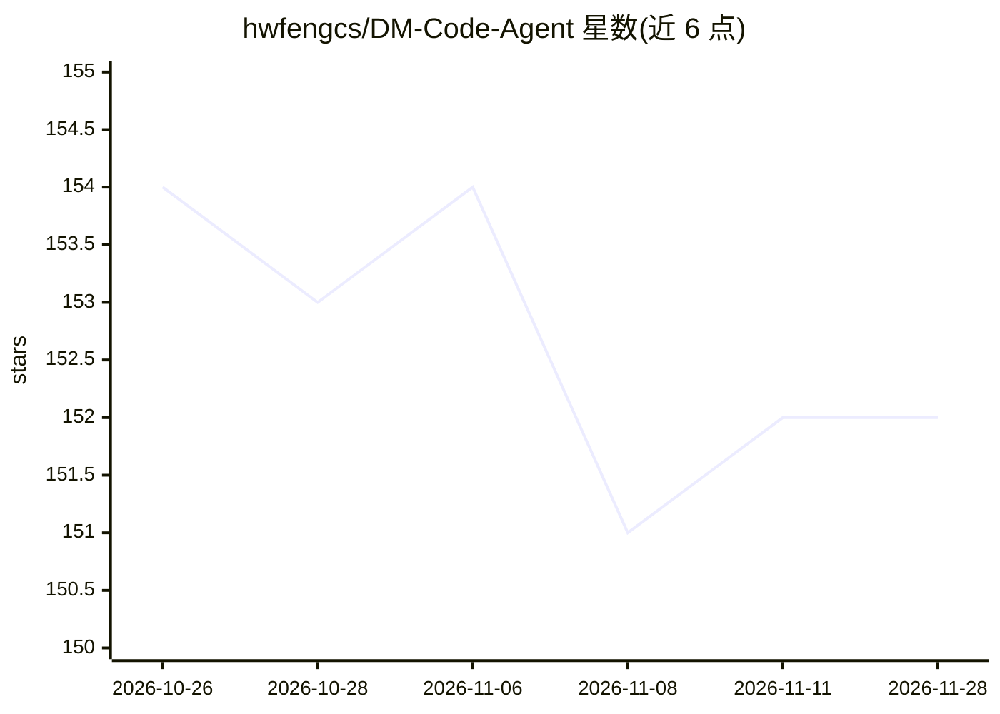

# hwfengcs/DM-Code-Agent

⭐ 152 · Python · MIT · 推送 2026-11-15 · [GitHub](https://github.com/hwfengcs/DM-Code-Agent) · [官网](https://hwfengcs.github.io/DM-Code-Agent/) · 个人维护 · 中文 README

**可审计的本地代码 Agent：追踪变更与测试证据**

在本地 Git 仓库中运行的代码 Agent，为每次运行维护 append-only 的执行记录，涵盖读取、编辑、命令与测试输出。提供终端追踪分析（dm-agent-trace analyze）、无服务器独立 HTML 报告导出与浏览器控制台；对未运行测试的修复给出 verification-gap 信号，支持轨迹对比与按任务基准回归。带 30 个隐藏测试任务的内置基准；无 API key 的演示用脚本客户端驱动真实 Agent，不含沙箱，Agent 以本地权限执行命令。

## 筛选速览

| 维度 | 判定 | 备注 |
|---|---|---|
| AI 角色 | `ai-ecosystem` | LLM/agent 周边工具 |
| 许可风险 | `permissive` | MIT |
| 部署形态 | `library` | 以包/库形式分发 |
| 模型依赖 | locked-api |  |
| 硬件要求 | — | 无带数字的原话,不猜 |
| 安装摩擦 | `low` | 无编译、无系统依赖或容器化 |
| 成熟度 | — | 结构信号不足 |

## 能力要点

- append-only 运行记录：工具调用、参数、观察与替换摘录按序可查
- verification-gap 信号标记未经测试验证的修复
- 独立 HTML 报告无需服务器即可打开，trace 默认脱敏
- 无 key 演示与确定性评测均不需 API key

## 适用场景

- 审查 Agent 在本地仓库中做了哪些修改、是否跑过测试
- 诊断 Agent 运行失败阶段与恢复尝试
- 导出 HTML 报告与同事共享测试证据
- 对比两次运行的轨迹并检查基准回归

## 场景标签

`编码 Agent` `LLM 可观测性` `模型评测` · 领域:编码与开发

## 证据(README 行号)

> L18: DM-Code-Agent works in your local repository and keeps an append-only record of each run.
> L73: Set your provider's key: `DEEPSEEK_API_KEY`, `OPENAI_API_KEY`, `CLAUDE_API_KEY`, or `GEMINI_API_KEY`.
> L97: The CLI and console share the same analysis functions. Standalone HTML reports need no server.

## 星数曲线

2026-10-26 154 → 2026-11-28 152（-2）

---
*卡片 v1 · prompt 1.4 · 生成 2026-11-28 · 置信度 high · 依据 README sha `61311a19435c` · [字段定义](../../DATASET.md)*
