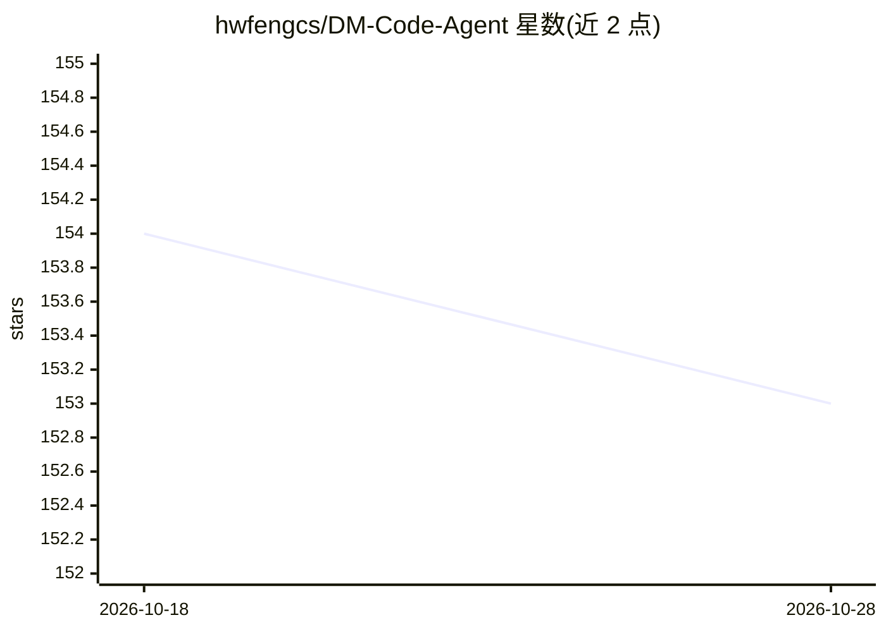

# hwfengcs/DM-Code-Agent

⭐ 153 · Python · MIT · 推送 2026-08-27 · [GitHub](https://github.com/hwfengcs/DM-Code-Agent) · 个人维护 · 中文 README

**本地优先、全程可审计的 Python Code Agent，内核仅一个 ReAct 循环**

面向开发者的 Python 代码 agent：在本地工作区读写文件、跑测试与 lint、调用 MCP 工具，内核为单一 ReAct 主循环，可选能力通过生命周期钩子扩展。每步计划、工具调用与观察写入 append-only 会话日志，支持回放、诊断、diff 与从任意步分叉重跑；上下文折叠不删原文且带净收益护栏，无收益则整体回滚。提供 CLI、可静态托管的只读 Web 审计展厅（免 API key）与完整工作台。自带 30 题隐藏测试 benchmark，另以官方 SWE-bench 4.1.0 harness 完成 50 题 Verified 运行（21/50）；SWE-bench Lite 子系统已在 v2.1 移除（跑不通）。限制：实际执行任务需配置 API key；项目不声明未实际运行的评测分数。

## 筛选速览

| 维度 | 判定 | 备注 |
|---|---|---|
| AI 角色 | `ai-native` | 本体是模型或模型工具 |
| 许可风险 | `permissive` | MIT |
| 部署形态 | `library` | 以包/库形式分发 |
| 模型依赖 | locked-api |  |
| 硬件要求 | — | 无带数字的原话,不猜 |
| 安装摩擦 | `low` | 无编译、无系统依赖或容器化 |
| 成熟度 | — | 结构信号不足 |

## 能力要点

- append-only 会话日志树：view/analyze/diff/fork/replay 五个 trace 命令
- 扩展系统：4 个注册方法 + 6 个可拦截生命周期钩子，不改内核加工具/守卫/供应商
- 自带 30 题隐藏测试 benchmark，输出逐题 pass/fail 翻转
- 无 API key 即可跑 554 个单元测试与 14 任务 × 4 变体确定性 eval

## 适用场景

- 在本地工作区让 agent 修 bug、改代码并跑测试验证
- 回放与审计 agent 运行过程，诊断失败阶段与验证缺口
- 研究者按需开启单个模块变量做 ablation 实验
- 通过浏览器对话式交任务并实时查看每一步执行

## 场景标签

`编码 Agent` `模型评测` · 领域:编码与开发

## 证据(README 行号)

> L18: 一个**你能读懂、能复现、能扩展**的 Python Code Agent。它在你本地工作区读写文件、跑测试、
> L22: 它不是又一个聊天黑盒：内核只有 ReAct 主循环，可选能力都是挂在
> L176: dm-agent-bench --suite all --provider deepseek --output bench_reports/after.json

## 星数曲线

2026-10-18 154 → 2026-10-28 153（-1）

---
*卡片 v1 · prompt 1.4 · 生成 2026-10-22 · 置信度 high · 依据 README sha `da2c4c4f4d4e` · [字段定义](../../DATASET.md)*
