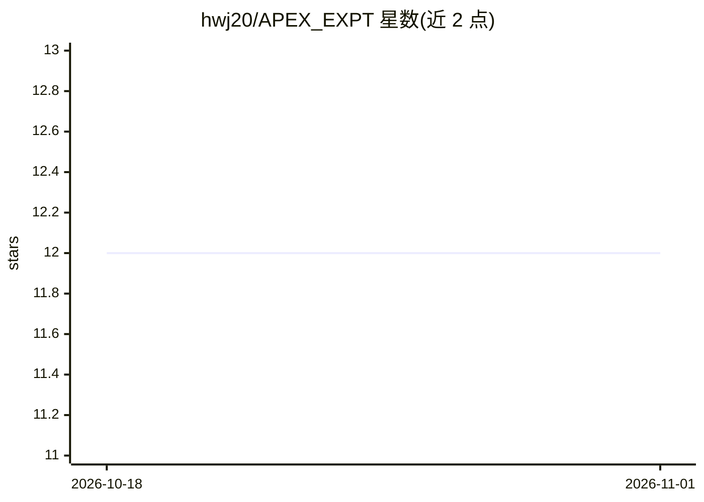

# hwj20/APEX_EXPT

⭐ 12 · Python · 推送 2026-02-27 · [GitHub](https://github.com/hwj20/APEX_EXPT) · 组织维护

**结合图物理感知与 LLM 推理的模块化决策框架**

面向不确定环境下推理与决策的混合框架：用 Graphormer 模型计算边级注意力分数以检测潜在物理风险，用物理模拟器预测动作结果，再由 LLM Planner 读取模拟摘要生成高层策略。实验覆盖俄罗斯方块规划与机器人避障（简单/中等/困难三档），指标含无碰撞率、无效动作率与平均存活时间，并对比 gpt-4o-mini、gpt-4o、VLM 基线。以论文形式发布，setup 仅给出 conda 创建环境命令。

## 筛选速览

| 维度 | 判定 | 备注 |
|---|---|---|
| AI 角色 | `ai-ecosystem` | LLM/agent 周边工具 |
| 许可风险 | `none` | — |
| 部署形态 | `None` |  |
| 模型依赖 | — | README 未给出锁定关系 |
| 硬件要求 | — | 无带数字的原话,不猜 |
| 安装摩擦 | `low` | 无编译、无系统依赖或容器化 |
| 成熟度 | — | 结构信号不足 |

## 能力要点

- Graphormer 触发器以边级注意力分数检测物理风险
- 物理模拟器预测动作结果，LLM Planner 生成策略
- 俄罗斯方块规划与三档难度避障实验，含 CFR/IAR/AST 指标
- 提供 gpt-4o-mini/gpt-4o/VLM 基线对比与真实世界测试

## 适用场景

- 在动态不确定环境中做带物理约束的任务规划
- 复现 LLM 物理推理避障与俄罗斯方块实验
- 研究物理模拟与 LLM 结合的决策方法

## 场景标签

`科研工具` · 领域:学习与行业

## 证据(README 行号)

> L25: APEX is a hybrid framework designed for reasoning and decision-making under uncertainty. It uses a Graphormer model
> L30: - **LLM Planner**: Uses simulation summaries to suggest safe and effective actions.

## 星数曲线

2026-10-18 12 → 2026-11-01 12（+0）

---
*卡片 v1 · prompt 1.4 · 生成 2026-11-01 · 置信度 mid · 依据 README sha `e7caab620b88` · [字段定义](../../DATASET.md)*
