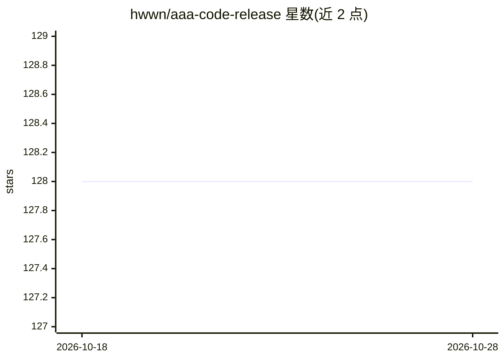

# hwwn/aaa-code-release

⭐ 128 · 推送 2026-06-26 · [GitHub](https://github.com/hwwn/aaa-code-release) · [官网](https://aaa-code.app) · 个人维护 · 中文 README

**Claude Code 跨平台桌面客户端：多工作区、远程访问、多模型接入**

由 hwwn 构建的 Claude Code 桌面 GUI 客户端，封装 Anthropic Agent SDK。功能包括多项目目录同会话、会话树分支与回溯（fork）、手机/平板经 WiFi 或 Cloudflare 隧道远程查看与审批权限、图片拖入对话、五种权限模式、定时任务（VIP+）。支持 Anthropic、DeepSeek、智谱、Kimi、MiniMax、Bedrock、Vertex 及 LiteLLM 自定义代理。分发为闭源二进制（dmg/exe/AppImage），基础功能免费，VIP/VVIP 为一次性付费解锁高级功能。

## 筛选速览

| 维度 | 判定 | 备注 |
|---|---|---|
| AI 角色 | `ai-ecosystem` | LLM/agent 周边工具 |
| 许可风险 | `none` | — |
| 部署形态 | `desktop` | 安装包/桌面程序 |
| 模型依赖 | locked-api |  |
| 硬件要求 | — | 无带数字的原话,不猜 |
| 安装摩擦 | `low` | 无编译、无系统依赖或容器化 |
| 成熟度 | — | 结构信号不足 |

## 能力要点

- 封装 Agent SDK 的跨平台 GUI（macOS/Windows/Linux）
- 多项目目录作为同一会话上下文
- 会话树节点 fork 与分支管理
- 手机/平板远程查看进度与审批工具调用（WiFi/Cloudflare 隧道）
- 多模型接入：Anthropic/DeepSeek/智谱/Kimi/MiniMax/Bedrock/Vertex/LiteLLM

## 适用场景

- 在桌面 GUI 中使用 Claude Code 而非终端 CLI
- 从手机远程跟进并审批正在运行的任务
- 在一条对话中同时引用多个代码仓库
- 切换不同 LLM 提供商运行会话

## 场景标签

`编码 Agent` · 领域:编码与开发

## 证据(README 行号)

> L5: A full desktop client for Claude Code that wraps the Agent SDK with everything the CLI should have had.
> L14: > **AAA Code** is a cross-platform **Claude Code desktop client** built by **hwwn** (Haowen Liu). It wraps Anthropi
> L38: Anthropic direct, DeepSeek, Zhipu, Kimi, MiniMax, AWS Bedrock, Google Vertex — or point at your own LiteLLM proxy. 

## 星数曲线

2026-10-18 128 → 2026-10-28 128（+0）

---
*卡片 v1 · prompt 1.4 · 生成 2026-10-22 · 置信度 high · 依据 README sha `a253025a26ea` · [字段定义](../../DATASET.md)*
