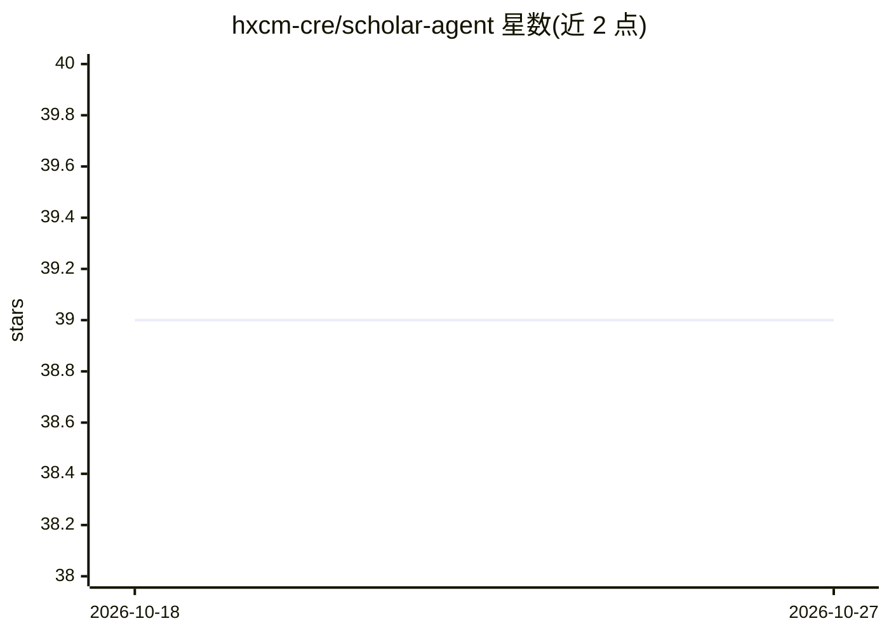

# hxcm-cre/scholar-agent

⭐ 39 · Python · GPL-3.0 · 推送 2026-05-02 · [GitHub](https://github.com/hxcm-cre/scholar-agent) · [官网](https://scholar-agent-three.vercel.app) · 个人维护 · 中文 README

**对话式 AI 学术研究助手：检索、阅读与分析论文**

面向科研人员的多轮对话 AI 助手，采用中心 LLM 控制器加专用技能的 hub-and-spoke 架构，自主决定何时检索新论文或分析已有文献。技能包括跨 arXiv 与本地 Zotero 的文献搜索（LangGraph 流水线）、全文深度阅读、跨会话的持久知识库与自动编号引用。技术栈为 Python 3.11+/FastAPI 后端加 React 前端，本地部署需分别启动 Redis、Uvicorn 后端、Celery Worker 与前端四个进程，配置环境变量后使用。README 为双语（含简体中文）。

## 筛选速览

| 维度 | 判定 | 备注 |
|---|---|---|
| AI 角色 | `ai-native` | 本体是模型或模型工具 |
| 许可风险 | `viral` | GPL-3.0 |
| 部署形态 | `desktop` | 安装包/桌面程序 |
| 模型依赖 | — | README 未给出锁定关系 |
| 硬件要求 | — | 无带数字的原话,不猜 |
| 安装摩擦 | `low` | 无编译、无系统依赖或容器化 |
| 成熟度 | — | 结构信号不足 |

## 能力要点

- 中心 LLM 控制器通过工具调用自主调度搜索与分析技能
- 跨 arXiv 与本地 Zotero 的文献搜索流水线（LangGraph）
- 全文深度阅读与论文侧栏阅读器
- 持久知识库：多会话保留已发现论文并自动编号引用

## 适用场景

- 对话式发现与筛选领域最新论文
- 让 AI 解释某篇论文的方法论
- 结合本地 Zotero 库检索并管理文献

## 场景标签

`科研工具` `RAG` · 领域:知识与检索

## 证据(README 行号)

> L14:  Scholar-Agent is a multi-turn, conversational AI assistant that helps researchers discover, read, and analyze acad
> L18: - 💬 **Multi-turn Dialogue**: A ChatGPT-like conversational interface for natural research exploration.
> L20: - 🔍 **Scholar Search Skill**: An upgraded LangGraph pipeline that searches across arXiv and local Zotero libraries,

## 星数曲线

2026-10-18 39 → 2026-10-27 39（+0）

---
*卡片 v1 · prompt 1.4 · 生成 2026-10-25 · 置信度 high · 依据 README sha `0a7f4d01f56d` · [字段定义](../../DATASET.md)*
