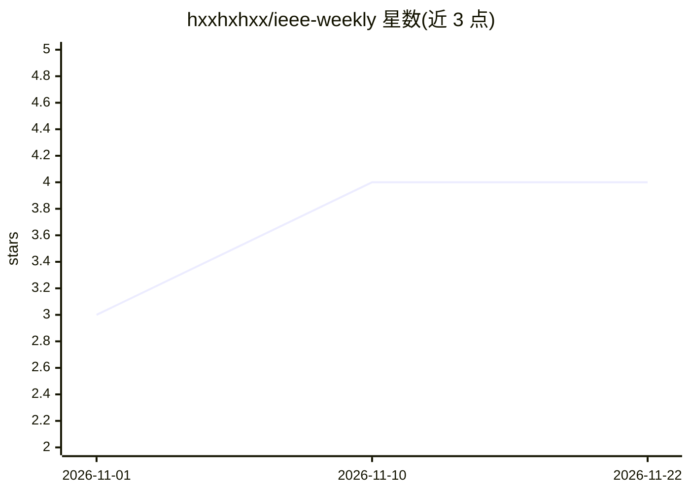

# hxxhxhxx/ieee-weekly

⭐ 4 · JavaScript · MIT · 推送 2026-10-30 · [GitHub](https://github.com/hxxhxhxx/ieee-weekly) · 个人维护 · 中文 README

**面向科研人员的 IEEE 期刊 Early Access 关键词周报工具**

通过 Crossref API 抓取指定期刊近 N 天新收录的 DOI，再从 IEEE Xplore 获取摘要与 Early Access 标记，按 config.json 中的关键词初筛后逐篇研判打分（DeepSeek 模型或规则模式），生成 Markdown 周报与 HTML 邮件推送，并用已读 DOI 列表去重。面向化合物半导体（GaAs/GaN/InP）功率放大器方向的科研人员。限制：IEEE 摘要与 Early Access 标记需机构 IP 访问，校外需 VPN，否则降级为仅 Crossref 标题+日期；依赖 Node.js ≥ 20；仅个人科研使用，不下载全文。

## 筛选速览

| 维度 | 判定 | 备注 |
|---|---|---|
| AI 角色 | `ai-ecosystem` | LLM/agent 周边工具 |
| 许可风险 | `permissive` | MIT |
| 部署形态 | `library` | 以包/库形式分发 |
| 模型依赖 | locked-api |  |
| 硬件要求 | — | 无带数字的原话,不猜 |
| 安装摩擦 | `low` | 无编译、无系统依赖或容器化 |
| 成熟度 | `idea` | |

## 能力要点

- Crossref → IEEE Xplore → LLM 研判 → Markdown/邮件的每周自动流水线
- 关键词、期刊 ISSN、评分阈值、研判模型集中在 config.json 配置
- 同包兼作 CLI 与 DSH 插件，注册 ieee_weekly 工具可被 agent 调用
- 记录已读 DOI（最多 5000 条）自动去重，报告附每篇分数与理由

## 适用场景

- 每周自动汇总 IEEE 期刊功率放大器方向的新收录论文
- 提前看到 Early Access 阶段的同行进展
- 把论文筛选结果定时推送到邮箱
- 在 DSH 中对 agent 说一句话触发周报生成

## 场景标签

`科研工具` · 领域:学习与行业

## 证据(README 行号)

> L24:    → 关键词初筛 + 逐篇研判（DeepSeek 或规则打分）
> L121: **已经做成插件了**：同一个包既是 CLI，也是 DSH 插件（`dsh` 字段 + `cordis.patch.yml` + `index.js`），注册一个模型可调用的 `ieee_weekly` 工具。
> L138: IEEE 的摘要和 Early Access 标记需要机构 IP（脚本会检测并在报告里提示）。校外请先连学校 VPN，或改成只用 Crossref 的标题+日期（会自动降级，但研判质量下降）。

## 星数曲线

2026-11-01 3 → 2026-11-22 4（+1）

---
*卡片 v1 · prompt 1.4 · 生成 2026-11-21 · 置信度 mid · 依据 README sha `c5bd5414b734` · [字段定义](../../DATASET.md)*
