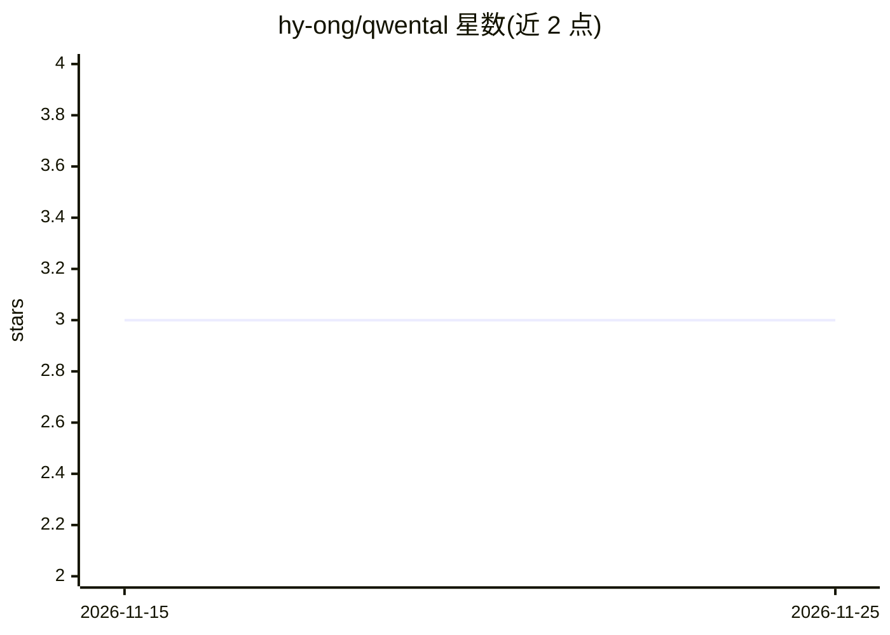

# hy-ong/qwental

⭐ 3 · C · MIT · 推送 2026-11-11 · [GitHub](https://github.com/hy-ong/qwental) · 个人维护

**面向开发者的本地 LLM 推理服务器：在 Apple M5 Max 上运行 Qwen3.8-Flash-Next**

用 C23 与 Metal 4 张量 API 编写的推理引擎，以服务器形式提供 GGUF 与 MLX 两种权重的本地推理，支持投机解码、批量预填充、前缀缓存与最多 64 路并发请求。对外暴露 Anthropic Messages 与 OpenAI Chat Completions 两类 API，Claude Code 等 Anthropic/OpenAI 客户端可直接接入。仅支持单一机型（M5 Max 128 GB），总吞吐在约 8 路并发后不再增长，模型权重需另行下载。

## 筛选速览

| 维度 | 判定 | 备注 |
|---|---|---|
| AI 角色 | `ai-ecosystem` | LLM/agent 周边工具 |
| 许可风险 | `permissive` | MIT |
| 部署形态 | `None` |  |
| 模型依赖 | — | README 未给出锁定关系 |
| 硬件要求 | — | 无带数字的原话,不猜 |
| 安装摩擦 | `medium` | 含编译或系统依赖之一 |
| 成熟度 | — | 结构信号不足 |

## 能力要点

- 提供 Anthropic Messages 与 OpenAI Chat Completions 兼容 API（流式、thinking、tool use）
- 支持 GGUF 量化权重直接加载与 DFlash2 投机解码
- INT8 预填充选项（--int8 / --int8-qk）加速长提示词处理
- 内置 /status 与 /dashboard 实时监控页面，支持英文与繁体中文

## 适用场景

- 在 Apple M5 Max 上本地运行 Qwen3.8-Flash-Next 并接入 Claude Code
- 为多个 agent 并发请求提供本地推理服务
- 通过 /dashboard 监控本地推理服务的用量与资源

## 场景标签

`推理引擎` · 领域:训练与推理

## 证据(README 行号)

> L96: - Anthropic Messages API: `/v1/messages` (streaming, thinking, tool use) and `/v1/messages/count_tokens`
> L104: - Use Claude Code or any Anthropic/OpenAI client as the front end. Claude Code works fully: system messages inside
> L119: - One model, one machine (M5 Max)

## 星数曲线

2026-11-15 3 → 2026-11-25 3（+0）

---
*卡片 v1 · prompt 1.4 · 生成 2026-11-21 · 置信度 high · 依据 README sha `ae104de15ced` · [字段定义](../../DATASET.md)*
