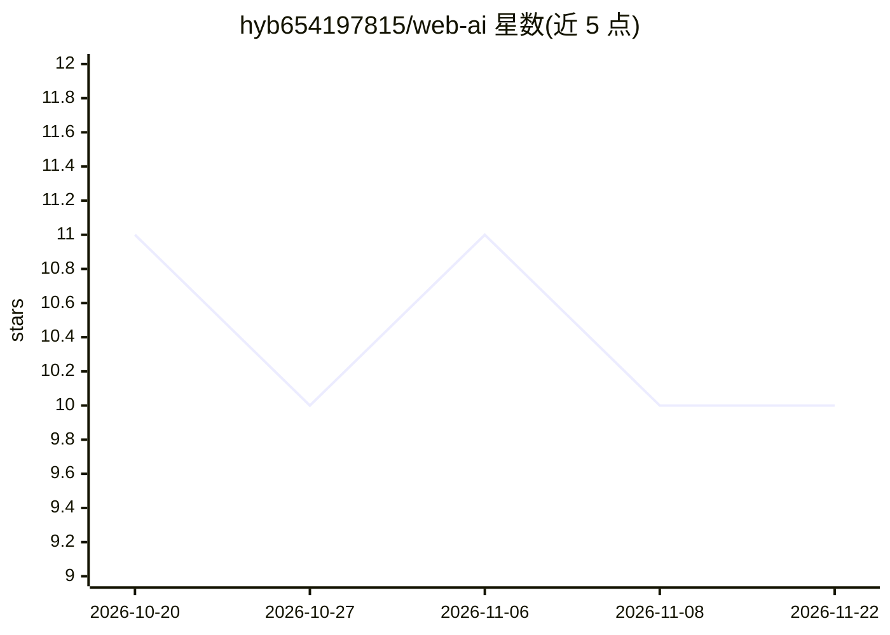

# hyb654197815/web-ai

⭐ 10 · JavaScript · MIT · 推送 2026-05-19 · [GitHub](https://github.com/hyb654197815/web-ai) · 个人维护 · 中文 README

**把前端业务页面接入 AI agent 能力的部件套件**

面向业务前端系统的页面级 AI agent 套件，由三部分组成：webGenerate 工作流可装入多种编码助手并从真实前端项目生成 webAIDocs 文档（routes.md 路由索引、page-xxx.md 页面知识）；FastAPI 后端负责鉴权、模型路由、MCP、计费、会话与知识托管；前端 widget 以 npm 包或 IIFE 形式嵌入 Web 应用，提供知识问答、受控路由导航与当前页操作。同一份文档同时服务开发期编码助手与运行时 agent。要求 Node.js>=18 与 Python 3.11+，需在管理台配置至少一个模型并上传文档 ZIP 后才能使用。

## 筛选速览

| 维度 | 判定 | 备注 |
|---|---|---|
| AI 角色 | `ai-ecosystem` | LLM/agent 周边工具 |
| 许可风险 | `permissive` | MIT |
| 部署形态 | `library` | 以包/库形式分发 |
| 模型依赖 | — | README 未给出锁定关系 |
| 硬件要求 | — | 无带数字的原话,不猜 |
| 安装摩擦 | `low` | 无编译、无系统依赖或容器化 |
| 成熟度 | — | 结构信号不足 |

## 能力要点

- webGenerate 支持装入 11 种编码助手（含 Codex/Claude Code/Cursor/Trae 等）并支持增量同步
- 一套 webAIDocs 文档同时服务编码助手与运行时前端 agent
- 内置 MCP server，暴露 list_routes/search_routes/get_page_doc/list_page_docs 工具
- 支持 ZIP 上传知识库、API key 鉴权及 selfAuth 短时令牌模式

## 适用场景

- 为管理后台、仪表盘等路由驱动型业务系统快速接入页面问答与导航 agent
- 让编码助手在修改前端代码前先理解业务页面结构
- 在管理台托管业务知识文档，免自建检索管道

## 场景标签

`文档问答` · 领域:知识与检索

## 证据(README 行号)

> L25: - FastAPI backend: handles auth, model routing, MCP, billing, sessions, and hosted knowledge docs
> L26: - frontend widget: plugs into your web app for knowledge Q&A, controlled navigation, and current-page actions

## 星数曲线

2026-10-20 11 → 2026-11-22 10（-1）

---
*卡片 v1 · prompt 1.4 · 生成 2026-11-19 · 置信度 high · 依据 README sha `0e7e766dfdff` · [字段定义](../../DATASET.md)*
