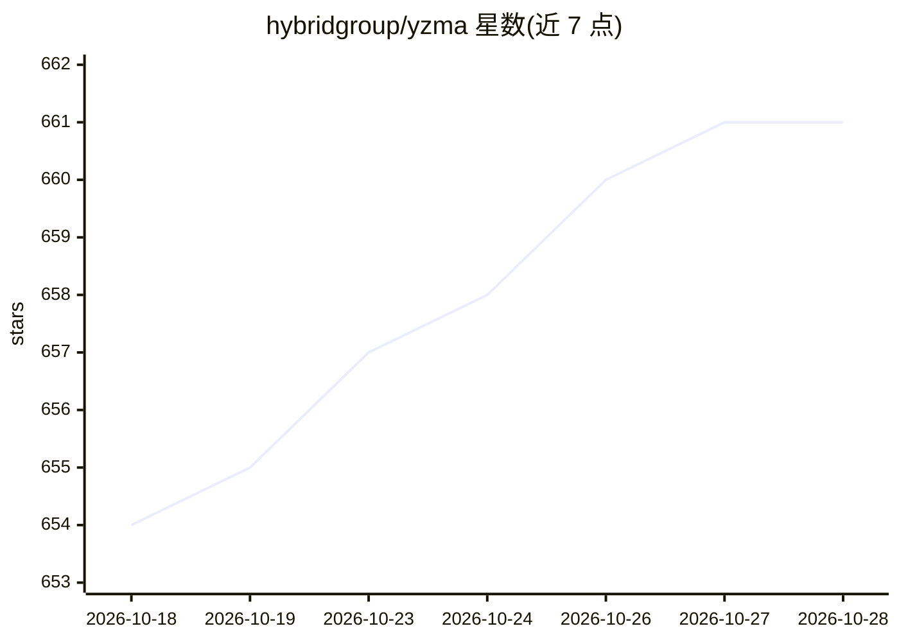

# hybridgroup/yzma

⭐ 661 · Go · NOASSERTION · 推送 2026-10-27 · [GitHub](https://github.com/hybridgroup/yzma) · [官网](https://yzma.ai) · 组织维护

**Go 库：在 Go 应用中直接集成 llama.cpp 做本地推理**

Go 语言库，通过 purego/ffi 在无需 CGo 与 C 编译器的情况下直接调用 llama.cpp 库，让 Go 程序在同一进程内运行本地 LLM/VLM 推理，支持 CUDA、Metal、OpenVINO、Vulkan 等硬件加速，覆盖 Linux/macOS/Windows，并可用 TinyGo 编译到 WebAssembly 在浏览器内运行（含 WebGPU 后端）。命令行工具负责下载 llama.cpp 预编译库与 GGUF 模型并做 SHA-256 校验，README 给出与各版本 llama.cpp 的兼容对照表。

## 筛选速览

| 维度 | 判定 | 备注 |
|---|---|---|
| AI 角色 | `ai-ecosystem` | LLM/agent 周边工具 |
| 许可风险 | `none` | NOASSERTION |
| 部署形态 | `library` | 以包/库形式分发 |
| 模型依赖 | local-ok | 支持本地模型 |
| 硬件要求 | — | 无带数字的原话,不猜 |
| 安装摩擦 | `medium` | 含编译或系统依赖之一 |
| 成熟度 | — | 结构信号不足 |

## 能力要点

- 基于 purego/ffi 直接调用 llama.cpp，无需 CGo 与 C 编译器
- 同进程函数调用推理，无需外部模型服务器
- 支持 TinyGo + WebAssembly 在浏览器内运行（WebGPU/多线程/单线程三种构建）
- CLI 下载预编译库与 GGUF 模型，附 SHA-256 校验

## 适用场景

- 在 Go 程序中嵌入本地 LLM/VLM 推理而不依赖外部服务
- 用 TinyGo 把语言模型编译进浏览器端应用，模型不离本机
- 在树莓派、Jetson Orin 等设备上运行 GGUF 模型

## 场景标签

`推理引擎` · 领域:训练与推理

## 证据(README 行号)

> L7: `yzma` lets you write Go applications that directly integrate `llama.cpp` for fully local inference using hardware a
> L12: - `yzma` uses the `purego` and `ffi` packages so CGo is not needed.
> L181: `yzma` is fast because it calls `llama.cpp` in the same process. No external servers needed!

## 星数曲线

2026-10-18 654 → 2026-10-28 661（+7）

---
*卡片 v1 · prompt 1.4 · 生成 2026-10-22 · 置信度 high · 依据 README sha `41915c21fd38` · [字段定义](../../DATASET.md)*
