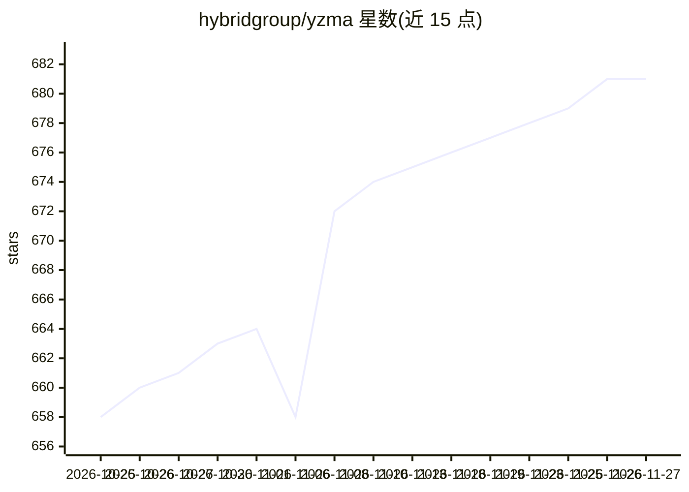

# hybridgroup/yzma

⭐ 681 · Go · NOASSERTION · 推送 2026-11-26 · [GitHub](https://github.com/hybridgroup/yzma) · [官网](https://yzma.ai) · 组织维护

**Go 应用直接集成 llama.cpp 做本地推理的绑定库**

面向 Go 开发者的本地推理库：通过 purego/ffi 直接链接 llama.cpp 库，在 Go 程序内完成 LLM/VLM 推理，无需外部模型服务器，也无需 CGo 与 C 编译器。支持 Linux/macOS/Windows，并可通过 TinyGo + WebAssembly 在浏览器运行（WebGPU/CPU）。yzma 命令行工具按平台下载 llama.cpp 预编译库（自动探测 CUDA/ROCm，SHA-256 校验），并提供模型下载命令。文档给出与 llama.cpp 各版本号一一对应的兼容表。

## 筛选速览

| 维度 | 判定 | 备注 |
|---|---|---|
| AI 角色 | `ai-ecosystem` | LLM/agent 周边工具 |
| 许可风险 | `none` | NOASSERTION |
| 部署形态 | `library` | 以包/库形式分发 |
| 模型依赖 | local-ok | 支持本地模型 |
| 硬件要求 | — | 无带数字的原话,不猜 |
| 安装摩擦 | `medium` | 含编译或系统依赖之一 |
| 成熟度 | — | 结构信号不足 |

## 能力要点

- Go 直接同进程调用 llama.cpp，无需外部服务器、CGo 或 C 编译器
- 支持 CUDA/Metal/OpenVINO/Vulkan 等硬件加速，含 Raspberry Pi/Jetson/Arduino UNO Q 安装指引
- TinyGo+WebAssembly 浏览器运行，三种构建（WebGPU/多线程/单线程）自动选择
- yzma CLI 下载预编译库与 GGUF 模型，带 SHA-256 校验与版本兼容表

## 适用场景

- 在 Go 应用中内嵌本地 LLM/VLM 推理，不部署模型服务
- 纯本地推理，模型不离开用户机器
- 在浏览器端运行文本生成或图片理解
- 跨平台（含树莓派/Jetson）分发无容器依赖的应用

## 场景标签

`推理引擎` · 领域:训练与推理

## 证据(README 行号)

> L7: `yzma` lets you write Go applications that directly integrate `llama.cpp` for fully local inference using hardware a
> L12: - `yzma` uses the `purego` and `ffi` packages so CGo is not needed.
> L216: The idea is to make it easier for Go developers to use language models as part of "normal" applications without ha

## 星数曲线

2026-10-25 658 → 2026-11-27 681（+23）

---
*卡片 v1 · prompt 1.4 · 生成 2026-11-27 · 置信度 high · 依据 README sha `e7e1e03d4d04` · [字段定义](../../DATASET.md)*
