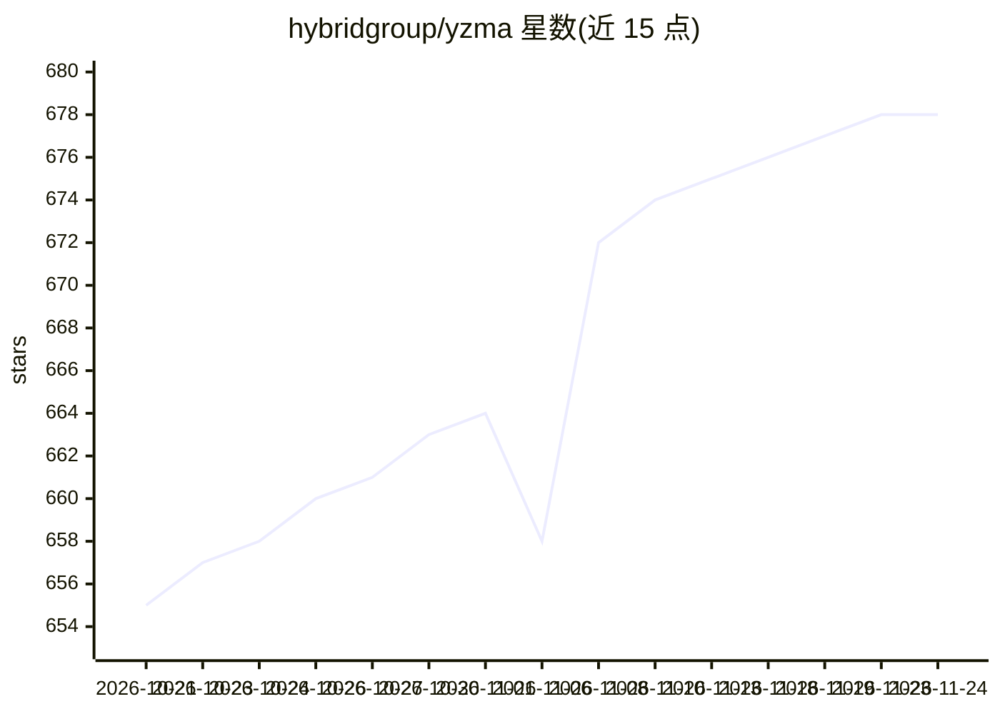

# hybridgroup/yzma

⭐ 678 · Go · NOASSERTION · 推送 2026-11-19 · [GitHub](https://github.com/hybridgroup/yzma) · [官网](https://yzma.ai) · 组织维护

**Go 开发者本地推理库：直接集成 llama.cpp 并支持硬件加速**

面向 Go 开发者的推理集成库，通过 purego/ffi 直接调用 llama.cpp 库，无需 CGo 与外部模型服务器，在同进程内完成文本生成、VLM 多模态推理与 embeddings。支持 Linux/macOS/Windows 及 TinyGo+WebAssembly 浏览器运行（CPU 或 WebGPU）。自带 CLI 工具按平台下载预编译 llama.cpp 库并做 SHA-256 校验，自动检测 CUDA/ROCm，提供版本兼容表。需自行获取 GGUF 模型文件，且 llama.cpp 破坏性变更需升级 yzma。

## 筛选速览

| 维度 | 判定 | 备注 |
|---|---|---|
| AI 角色 | `ai-ecosystem` | LLM/agent 周边工具 |
| 许可风险 | `none` | NOASSERTION |
| 部署形态 | `library` | 以包/库形式分发 |
| 模型依赖 | local-ok | 支持本地模型 |
| 硬件要求 | — | 无带数字的原话,不猜 |
| 安装摩擦 | `medium` | 含编译或系统依赖之一 |
| 成熟度 | — | 结构信号不足 |

## 能力要点

- 无需 CGo，通过 purego/ffi 同进程调用 llama.cpp，无外部服务器
- 支持 CUDA、Metal、OpenVINO、Vulkan 等硬件加速，自动检测 CUDA/ROCm
- TinyGo+WebAssembly 浏览器运行，模型不出本机
- CLI 下载预编译库与 GGUF 模型并做 SHA-256 校验

## 适用场景

- 在 Go 应用中直接嵌入本地 LLM/VLM 推理
- 在浏览器中运行完全不联网的文本/图像模型
- 跨平台交叉编译带推理能力的 Go 程序

## 场景标签

`推理引擎` · 领域:训练与推理

## 证据(README 行号)

> L7: `yzma` lets you write Go applications that directly integrate `llama.cpp` for fully local inference using hardware a
> L12: - `yzma` uses the `purego` and `ffi` packages so CGo is not needed.
> L214: The idea is to make it easier for Go developers to use language models as part of "normal" applications without ha

## 星数曲线

2026-10-21 655 → 2026-11-24 678（+23）

---
*卡片 v1 · prompt 1.4 · 生成 2026-11-24 · 置信度 high · 依据 README sha `505a2a67f68f` · [字段定义](../../DATASET.md)*
