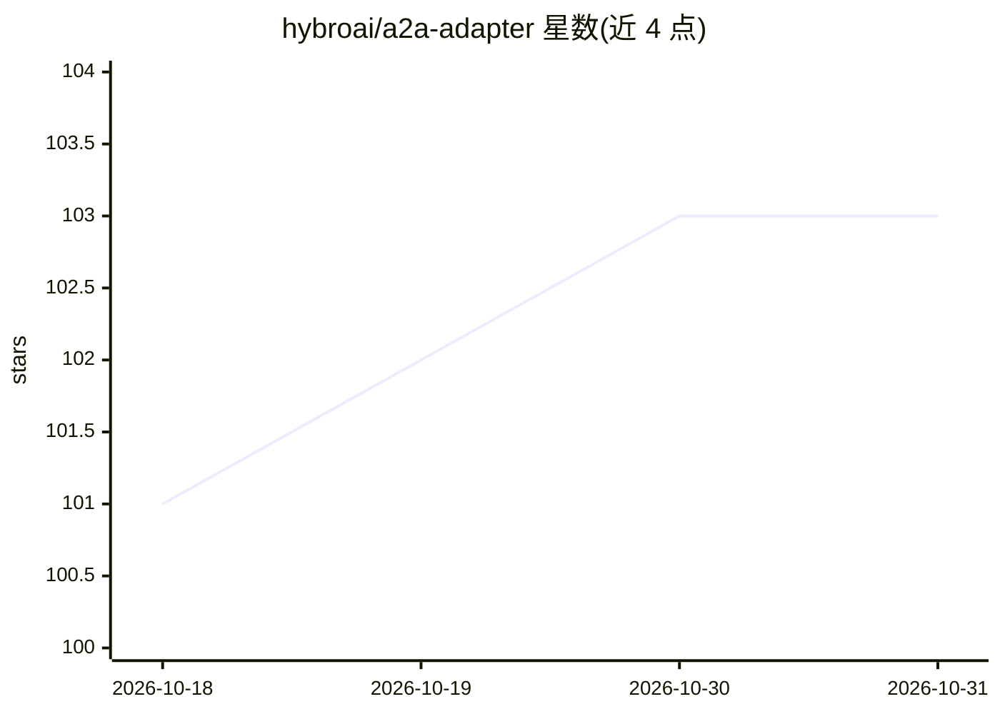

# hybroai/a2a-adapter

⭐ 103 · Python · Apache-2.0 · 推送 2026-10-30 · [GitHub](https://github.com/hybroai/a2a-adapter) · [官网](https://pypi.org/project/a2a-adapter/) · 组织维护

**把各类 AI agent 封装为 A2A 协议服务器的 Python SDK/CLI**

通过官方 A2A SDK 将 agent CLI（Claude Code、Codex、Pi、OpenClaw）、本地 agent（Ollama、Hermes）、工作流引擎（n8n）及 Python agent 框架（LangChain、LangGraph、CrewAI）封装为 A2A 协议服务器，自动处理 AgentCard 生成、JSON-RPC、任务生命周期与流式传输。提供两种用法：SDK 方式在代码中调用 serve_agent；CLI 方式用单条命令将已有本地 agent 暴露为 A2A 服务。适配器不安装被封装的 agent，agent 须可独立运行，需 Python 3.11+。

## 筛选速览

| 维度 | 判定 | 备注 |
|---|---|---|
| AI 角色 | `ai-ecosystem` | LLM/agent 周边工具 |
| 许可风险 | `permissive` | Apache-2.0 |
| 部署形态 | `library` | 以包/库形式分发 |
| 模型依赖 | local-ok | 支持本地模型 |
| 硬件要求 | — | 无带数字的原话,不猜 |
| 安装摩擦 | `low` | 无编译、无系统依赖或容器化 |
| 成熟度 | — | 结构信号不足 |

## 能力要点

- 覆盖 12 类适配器：Claude Code/Codex/Pi/OpenClaw/n8n/LangGraph/LangChain/CrewAI/Ollama 等
- 基于官方 A2A SDK 处理 AgentCard、JSON-RPC、任务生命周期与流式
- CLI 单命令将本地 agent 暴露为 A2A 服务器，自动生成 Agent Card

## 适用场景

- 让自己的 Python agent 或框架 agent 对外提供 A2A 协议服务
- 把 Claude Code、Codex 等本地 agent CLI 接入 A2A 生态
- 统一多种 agent 的 A2A 接入方式

## 场景标签

`Agent 框架` · 领域:Agent 开发

## 证据(README 行号)

> L10: `a2a-adapter` wraps agent CLIs, local agents, workflow engines, and Python agent
> L12: It handles AgentCard generation, JSON-RPC, task lifecycle, and streaming through

## 星数曲线

2026-10-18 101 → 2026-10-31 103（+2）

---
*卡片 v1 · prompt 1.4 · 生成 2026-10-23 · 置信度 mid · 依据 README sha `10b26933b7f8` · [字段定义](../../DATASET.md)*
